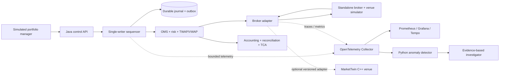

# EXECUTRACE

**EXECUTRACE is a planned, event-sourced equity execution simulator with an independent observability and incident-diagnostics pipeline.**

A portfolio manager's decision to trade is only the beginning of an execution workflow. Orders must pass risk checks, be scheduled into child orders, survive broker uncertainty and duplicate messages, and reconcile to positions and cash. EXECUTRACE is an educational engineering project to make those transitions explicit, durable, testable, and observable. It does not choose securities or predict returns.

> **Status: Phase 1 Java execution core implemented and tested.** The durable OMS reducer, single-writer admission, SQLite journal/outbox, snapshots, idempotency and replay are present. Risk reservations, TWAP/VWAP, a broker/venue simulator, control API, telemetry and diagnostics remain **PLANNED — NOT IMPLEMENTED**. The authoritative contract is [architecture.md](architecture.md).

## What the system will simulate

- **Execution stack:** portfolio/account instruction, parent order, child orders, broker session, venue, and post-trade projections.
- **Safe order lifecycle:** pre-trade reservations, acknowledgments, partial fills, cancel/replace races, duplicate reports, unknown outcomes, and reconciliation.
- **Algorithms:** deterministic TWAP first, then VWAP scheduling against a recorded, normalized intraday volume curve. These optimize execution of a given instruction; they do not generate trade ideas.
- **Operational behavior:** distributed traces, bounded metrics and logs, queue and JVM health, deterministic faults, statistical anomaly detection, and evidence-based incident reports.

### A concrete planned run

A portfolio manager submits a **BUY of 50,000 AAPL shares** with an account, price limit, and execution window. The Java sequencer records the request, the risk gateway reserves exposure, and the VWAP scheduler assigns a cumulative share target from a predefined volume curve. It sends child orders through a broker adapter to the standalone simulated broker/venue. Acknowledgments and partial fills become ordered business events; the OMS and accounting projections update once per unique execution. After completion, the run reports fill quantity, execution VWAP, participation, and reference-price slippage with the underlying benchmark identified. A seeded retry-storm fault then changes service-call frequency. Telemetry exposes the anomaly; the Python detector raises a structured alert; the investigator cites the traces and metrics behind its hypothesis. The fault's hidden ground truth is reserved for offline evaluation.



The first executable system is a modular Java process with a deterministic standalone broker simulator. Python diagnostics run separately. The dotted edges are best-effort monitoring or future integration, never authority for order state.

## Component responsibilities and status

| Component | Ownership and contract |
| --- | --- |
| OMS | Java reducer for parent/child lifecycle and quantity invariants. |
| Sequencer | One authoritative order for accepted commands and inbound broker reports. |
| Event journal | Durable append-only event stream and transactional outbox; replay source. |
| Risk gateway | Serial exposure reservations, limits, kill switch, and ambiguous-outcome holds. |
| TWAP/VWAP scheduler | Reproducible target quantities from recorded clocks, curves, and fills. |
| Broker adapter | Submit/cancel/replace/status boundary and report normalization. |
| Venue simulator | Seeded acknowledgments, fills, rejects, races, and faults. |
| Reconciliation | Compare broker-reported state to local fills, positions, and cash. |
| Telemetry | Bounded traces, metrics, structured logs, JVM profiling, collector. |
| Anomaly detector | Python statistical baselines and structured alerts. |
| AI investigator | Deterministic evidence timeline; optional model-generated explanation. |

## Technology choices

| Technology | Planned use | Why / alternative |
| --- | --- | --- |
| Java 21, Gradle | Framework-independent OMS, sequencer, risk, algorithms, broker handling; toolchains and dependency locking | Strong type system, mature JVM tooling and operational ergonomics. GC and scheduler pauses are measured, never assumed away. Spring Boot may serve management APIs later. |
| C++20 | Optional MarketTwin venue adapter or native performance experiment | Keep native ABI and failure domain outside the Java core; start with versioned socket/subprocess messages, not JNI. |
| Python 3.12+ | Offline anomaly detection, evaluation, bounded diagnostic API | Independent of the order path; deterministic non-LLM diagnostics first. |
| FIX 4.4 / QuickFIX/J | Protocol semantics reference; optional later session simulator | Learn NewOrderSingle, ExecutionReport, cancel, replace, reject, sequence and resend behavior without equating session delivery with exactly-once execution. |
| OpenTelemetry | Context propagation and spans/metrics/logs | Collector isolates exporters. Prometheus stores metrics, Grafana displays dashboards, Tempo can store traces, JFR profiles the JVM. |
| Local durable storage | Initially SQLite transactions for journal, outbox and snapshots | Small local footprint and a clear atomic boundary; a framed file WAL or PostgreSQL remain evaluated alternatives. |
| JUnit 5, AssertJ, jqwik, pytest, CTest | Reducer/property, diagnostics, and optional native adapter tests | Testcontainers only when integration warrants it. JMH isolates Java methods; end-to-end runs measure the whole workflow. |
| GitHub Actions / optional Compose | Reproducible correctness CI and later local multi-process demos | macOS and Linux x86-64 functional correctness; native Linux required for IRONBUS and credible Linux latency measurements. |

## Engineering questions the implementation must answer

- Can a snapshot and ordered event stream reconstruct the same business state with a fixed reducer version? What happens when input timing, market data, or random decisions are omitted?
- Can retries, duplicate execution reports, and restarts create **exactly-once BUSINESS EFFECTS under specified assumptions**, despite at-least-once delivery? This is not a universal exactly-once delivery claim.
- Does pending cancellation retain outstanding risk until a broker-confirmed outcome? Are fills during that interval counted correctly?
- Are unknown broker outcomes quarantined and reconciled before dispatch resumes?
- Can bounded queues reject or slow ingress without corrupting committed state? Can the telemetry collector fail without blocking the sequencer?
- Do anomaly and root-cause reports identify evidence and uncertainty, and are their precision, false alarms, and detection delay measured on held-out faults?
- Are throughput and latency reported as distributions with host, JVM, GC, workload, and repeated-run metadata?

## Roadmap

| Phase | Planned evidence gate | Status |
| --- | --- | --- |
| 0 | Architecture, Java 21/Gradle foundation, envelope schema and conventions | **FOUNDATION IMPLEMENTED**; further schemas arrive with their phases |
| 1 | Durable Java lifecycle, replay, idempotency, property and crash tests | **IMPLEMENTED — CORE TESTS PASS**; broker integration is Phase 3 |
| 2 | Serialized risk reservations, TWAP then VWAP, scheduling tests | **PLANNED — NOT IMPLEMENTED** |
| 3 | Standalone broker, fills/cancels, recovery, reconciliation/accounting | **PLANNED — NOT IMPLEMENTED** |
| 4 | Context propagation, metrics/traces/logs, collector-failure test | **PLANNED — NOT IMPLEMENTED** |
| 5 | Baseline detector and held-out fault evaluation | **PLANNED — NOT IMPLEMENTED** |
| 6 | Evidence retrieval, typed incident reports, optional LLM | **PLANNED — NOT IMPLEMENTED** |
| 7 | Crash/fault suite, end-to-end demo, measured characterization | **PLANNED — NOT IMPLEMENTED** |
| 8 | Optional FIX, MarketTwin, AegisFeed, IRONBUS and advanced algorithms | **PLANNED — NOT IMPLEMENTED** |

The 2–3 week target is a coherent local demonstration through the critical path, with evidence gates controlling scope. Phase 8 never blocks the first demo. Detailed sub-stages, tests, and completion criteria are in [architecture.md §23](architecture.md#23-phased-implementation-plan).

## Prerequisites and running status

**The Phase 1 test command works; there is no runnable execution demo or service yet.** Install Java 21 and Git, then run `./gradlew :execution-core:test` from the repository root. The Gradle wrapper downloads Gradle; dependencies are locked. Python 3.12+ is needed only for later diagnostics. Docker is optional for later integration; C++20/CMake are optional for native adapters. macOS is supported for functional development; Linux x86-64 is required for native IRONBUS experiments. Docker on Apple Silicon does not establish native x86-64 latency claims.

The following execution CLI is **illustrative and planned**, not a working command sequence:

```text
# PLANNED ONLY — execution commands and flags are proposed acceptance interfaces
./gradlew :execution-app:run --args='simulate --scenario normal-vwap --seed 17'
./gradlew :execution-app:run --args='replay-verify --run-id <id>'
python -m pytest ai-diagnostics/tests
```

Phase 1 currently provides a Java library and verified tests, not an operator CLI. Actual execution commands will be documented after implementation and verification. The final workflow should produce a run manifest, journal/replay digest, accounting and TCA report, traces/metrics, fault record, and incident evidence bundle.

## Validation philosophy

Correctness is specified by numbered invariants, a reference reducer, seeded stateful property tests, crash windows, and independent reconciliation. A smoke test alone cannot qualify a phase. Benchmarks must distinguish isolated JMH methods from end-to-end order processing; every result needs workload, host, runtime, warmup, repetitions, and latency distribution. Simulated execution quality is a measurement of the simulation, not evidence of real-market performance. AI claims require a held-out confusion matrix and cited evidence, not a persuasive narrative.

## Relationship to the other projects

[MarketTwin](https://github.com/MohitManna-2006/MarketTwin) owns C++ synthetic exchange matching, logical simulation, and experiment replay. EXECUTRACE owns the portfolio-to-broker execution workflow, risk, scheduling, OMS, reconciliation, and infrastructure diagnostics. MarketTwin currently documents a coarse per-run Python binding; a per-child-order adapter is **future work and requires contract verification or new APIs**. The first demo uses the standalone mock, without copying MarketTwin's matcher.

[AegisFeed](https://github.com/MohitManna-2006/AegisFeed) is a possible future source of normalized market data and gap/staleness signals. It is not required to synthesize the first volume curve. [IRONBUS](https://github.com/MohitManna-2006/IRONBUS) is an optional Linux x86-64 cross-process transport experiment, subject to payload-size and backpressure constraints; it is not the durable journal. [PulseKV](https://github.com/MohitManna-2006/pulsekv) informs durability/recovery thinking, but is not an execution-state dependency. [Sum100](https://github.com/MohitManna-2006/Sum100) offers contrasting paper-execution and feed-gap patterns, not an equities OMS contract. No current compatibility is claimed.

## Scope, contributions, and license

This is an independent educational research platform. It has no affiliation with Millennium Management, its employees, or any proprietary trading system. Non-goals include live brokerage trading, real-money order routing, stock-return prediction, alpha generation, reproducing a proprietary platform, and production-grade regulatory compliance certification. AI cannot approve or alter orders or risk controls.

Contributions should name the invariant or interface they affect, include reproducible evidence, and amend [architecture.md](architecture.md) or add an ADR before changing ordering, risk, event, or recovery semantics. Small, reviewable increments with failure tests are preferred.

**License:** no LICENSE file is present. No open-source license is claimed yet; the repository owner must choose and add one before others can rely on redistribution permissions.

## Public references

- [FIX Trading Community, FIX 4.4 resources](https://fixtrading.org/download-category/fix-4-4/) and [FIX order state changes](https://www.fixtrading.org/wp-content/uploads/download-manager-files/Order-State-Changes.pdf)
- [QuickFIX/J documentation](https://quickfixj.org/docs/overview/)
- [OpenTelemetry Java documentation](https://opentelemetry.io/docs/languages/java/) and [context propagation](https://opentelemetry.io/docs/concepts/context-propagation/)
- [Prometheus naming guidance](https://prometheus.io/docs/practices/naming/) and [Grafana documentation](https://grafana.com/docs/)
- [Oracle Java documentation](https://docs.oracle.com/en/java/)

See [architecture.md §29](architecture.md#29-inspected-references) for the full referenced engineering contract.
