# EXECUTRACE architecture and execution contract

## 0. Document authority

**Version:** 0.1.0. **Status:** Proposed architecture, documentation only (2026-11-05). **Audience:** implementers, reviewers, test authors, and AI coding agents. This document is the authoritative proposed contract; the README is its summary. A code implementation that disagrees with this document is an engineering discrepancy: fix code or approve an explicit design amendment. A future `docs/adr/NNNN-title.md` records context, alternatives, decision, consequences, migration, and tests; an ADR does not silently supersede this document. Update the affected section and schema version in the same change.

**Normative words:** MUST/MUST NOT are gates; SHOULD is the default unless an ADR gives evidence; MAY is optional. `PLANNED` means no implementation exists. Agents MUST read the relevant section and invariant IDs before editing; MUST NOT silently change event order, durable commit rules, idempotency keys, risk release, numeric scale, schemas, or replay. They MUST produce passing, failing, and recovery evidence for the stage they implement. No observed performance or AI accuracy is claimed here.

**Assumptions and limits:** one local operator, one execution process, simulated USD equities with whole shares and positive integer price ticks; no real broker, live credentials, shorting, corporate actions, or regulatory certification. A single simulated session uses one event sequencer. The first broker is a deterministic mock. External reports may be duplicated or delayed. Durable state survives a clean restart or process crash when the OS/storage honors SQLite sync; catastrophic disk loss or malicious storage modification is outside the guarantee. Examples use AAPL for illustration, not a trading recommendation.

**Terms:** *intent* is the user's instruction; *parent* is its total execution envelope; *child* is one routed order; *broker order* is the broker's acknowledged identifier; *venue order* is the matcher-side order; *business event* affects authoritative projection; *telemetry* is best effort; *outbox* is committed intent awaiting external transmission; *replay* applies recorded events without side effects; *reconciliation* compares local projection with broker state. **Exactly-once business effects** means one fill contributes at most once given stable execution IDs, durable deduplication, a deterministic reducer, and broker status/query support; it does not mean exactly-once delivery or eliminate ambiguous unqueryable broker outcomes.

## 1. Objectives and non-goals

| Tier | Objective and evidence |
| --- | --- |
| MVP, phases 1–3 | Accept a simulated order; persist every accepted transition; constrain child sizes and account exposure; schedule TWAP then VWAP from recorded inputs; recover projections; deduplicate fills; reconcile broker and accounting state. Demonstrate five order/failure traces. |
| Focused 2–3 week target, phases 4–7 | Expose correlated traces and bounded metrics; inject reproducible operational faults; detect anomalies using evaluated baselines; create cited incident reports; publish crash/fault and benchmark artifacts. Scope may narrow to one symbol/account/session while retaining evidence quality. |
| Extensions, phase 8 | FIX session simulator, MarketTwin adapter, AegisFeed data, IRONBUS transport, multi-venue and advanced algorithms after the standalone proof. |
| Exclusions | Live routing, real-money trades, alpha/return prediction, certification, cross-host consensus, high-availability claims, real broker onboarding. |

Ten measurable objectives: (1) simulate institutional equity execution, (2) track accepted transitions, (3) prevent duplicate economic effects, (4) maintain reserved risk, (5) reconstruct state, (6) reproduce schedule decisions with recorded environment, (7) reconcile broker state, (8) detect infrastructure anomalies, (9) explain incidents with evidence and uncertainty, (10) evaluate correctness/performance reproducibly. An operator selects the security/side/size; AI never does.

## 2. System topology and process boundaries

The **execution process** contains a thin control API, one command queue, single writer, pure reducers, SQLite journal/outbox, and initially an in-process mock broker with a separate logical broker-session module and venue-matcher module. The broker can later move to a subprocess with the same versioned adapter protocol. **Python diagnostics** reads exported telemetry and bounded read-only journal references; it has no command channel to the sequencer. Collector/Prometheus/Grafana/Tempo are optional later processes. Durable journal and outbox are critical; queues, span buffers, and dashboards are volatile. HTTP ingress waits for durable acceptance, not final fill. Queue-full returns 429/503 before commitment. External broker calls are asynchronous relative to sequencing; the writer never waits on network or telemetry.

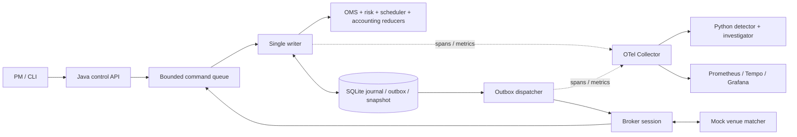

The ten operational views below show the *same* boundaries; dashed paths are best effort.

**Order entry:**
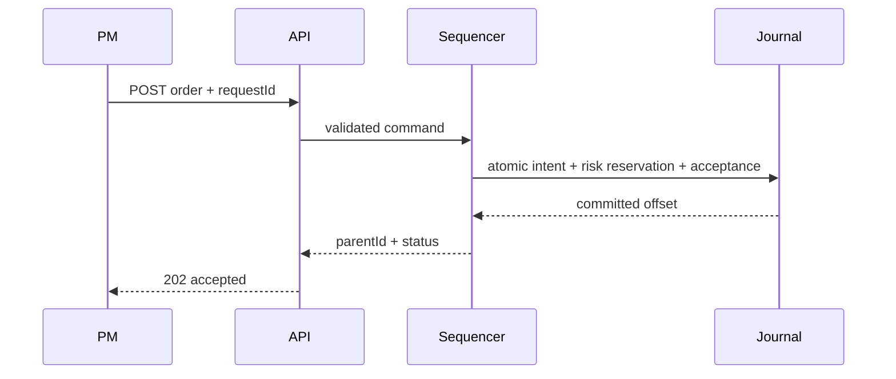

**VWAP:**
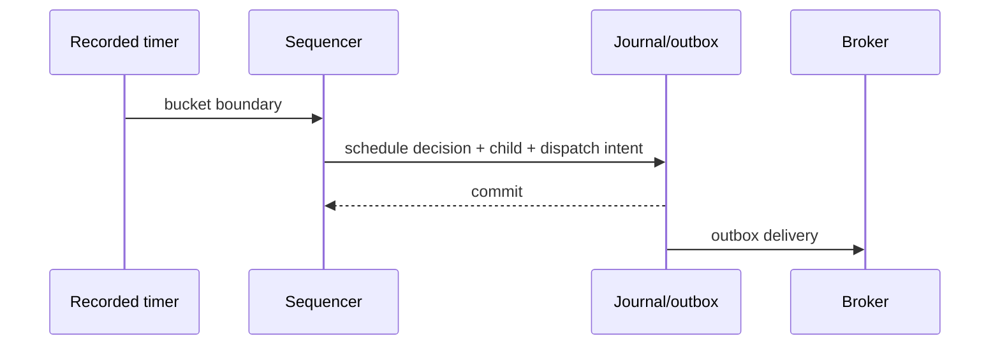

**Report processing:**
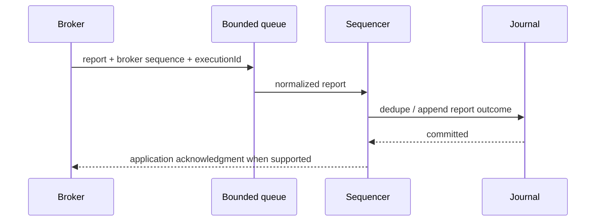

**Cancel/fill race:**
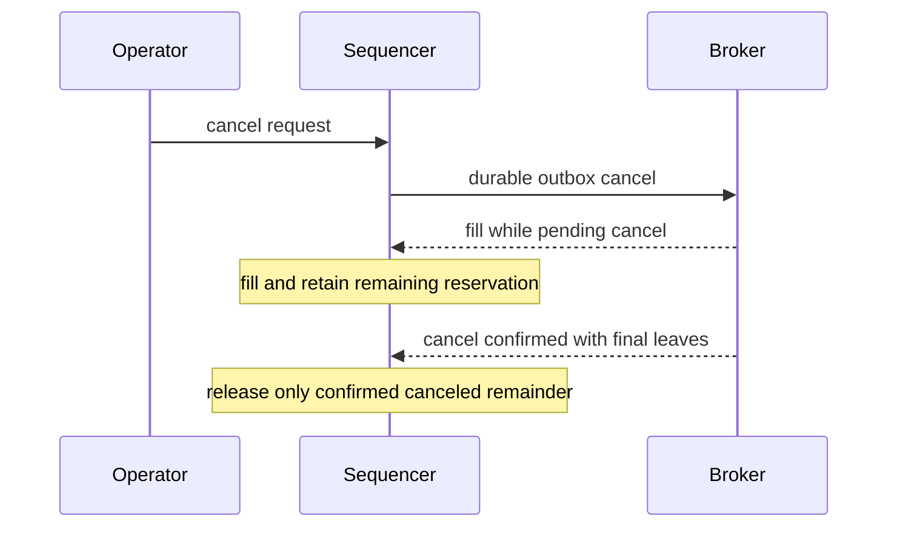

**Journal/replay:**
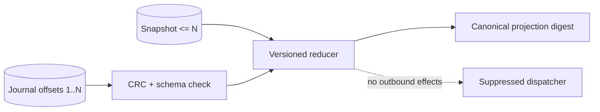

**Telemetry:**
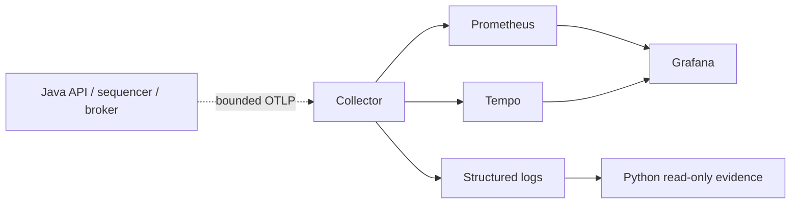

**Investigation:**
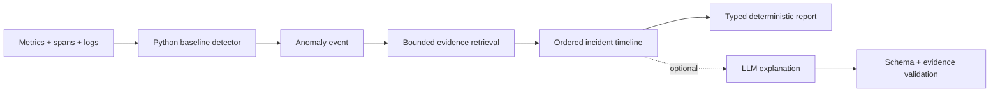

**Crash:**
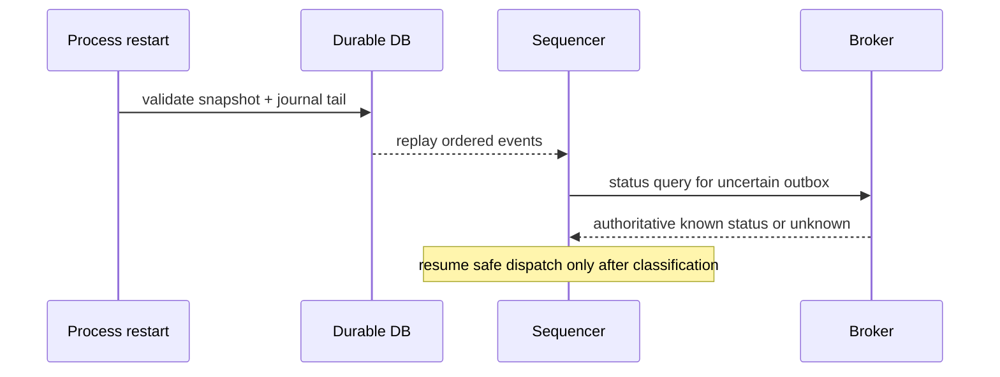

**Optional MarketTwin:**
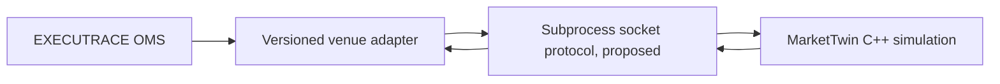

**Boundary rules:** sequencer input is a total order; outbound delivery and telemetry are not. Broker report receive time is not sequencing time. A broker outage pauses affected children and schedules reconciliation; it does not erase committed intents. Python/collector failures leave business state unchanged. Control API has bounded wait for acceptance; broker/venue latency is intentionally outside that wait. Every process boundary carries a protocol version, identity, and timeout.

## 3. Domain model and serialization

All authoritative entities are immutable value records in Java. Reducers replace records under the single writer; SQLite stores versioned canonical JSON events. Long quantities are whole shares (`1..9e12` configured stricter); prices are positive signed 64-bit **microunits of USD per share** (`1 USD = 1,000,000 ticks`), with per-instrument tick-size validation. Cash/notional use signed 64-bit micro-USD and `Math.multiplyExact`/`addExact`; overflow rejects the command or quarantines a report before state mutation. Decimal input uses `BigDecimal` parsing, exact conversion to ticks, and rejects excess fractional precision. Fees are integer micro-USD; fee conversion uses HALF_EVEN only where a noninteger external fee is explicitly modeled. Quantity averages and TCA ratios use rational numerator/denominator then decimal HALF_EVEN for display only. No binary floating point in business state.

| Entity (owner) | Identity; required fields and validation | Mutability / relation |
| --- | --- | --- |
| Portfolio (control) | `portfolioId UUID`, name 1–128 chars, allowed account IDs | configuration versioned; no implicit cross-account netting |
| Account (risk) | `accountId UUID`, portfolioId, currency=`USD`, enabled, creditLimitMicroUsd >=0 | risk/accounting aggregate; one sequencer serializes updates |
| Instrument (reference) | `symbol` uppercase 1–16, currency=`USD`, tickSizeMicroUsd>0, lotSize=1 | config revision recorded per run; symbol alone is not market data |
| TradingSession (sequencer) | `sessionId UUID`, start/end UTC, simulated origin, config revision, run seed | immutable; one symbol initially; timer inputs persisted |
| ExecutionInstruction (OMS) | `instructionId UUID`, account, symbol, BUY/SELL, qty>0, limit ticks, window, algorithm | original PM intent immutable; SELL requires available inventory in MVP |
| ParentOrder (OMS) | `parentOrderId UUID`, instructionId, originalQty, totalFilled, liveChildLeaves, status | projection from events; 1:N children; no child belongs to two parents |
| ChildOrder (OMS) | `childOrderId UUID`, parentId, clientOrderId, effectiveQty, cumQty, leavesQty, state, request state | projection; one accepted child has one parent and at most one active broker chain |
| ExecutionSchedule (scheduler) | `scheduleId UUID`, parentId, algorithm/version, bucket boundaries and rational weights | immutable revision; decisions reference revision |
| RiskLimit (risk) | account/symbol/scope, maxParentQty, maxChildQty, maxNotional, maxOutstanding, version | config changes sequenced; conservative until re-evaluated |
| RiskReservation (risk) | reservationId UUID, account, parent/child link, amountMicroUsd, state | derived from durable events; hold ambiguous leaves |
| BrokerOrder (broker adapter) | brokerOrderId string 1–64 after ack, clientOrderId, session, status, broker sequence | broker report fact, not local authority until sequenced |
| VenueOrder (mock venue) | venueOrderId string, brokerOrderId, leaves, price ticks, queue order | venue-owned; opaque to OMS; only mock venue mutates |
| ExecutionReport (adapter) | reportId, broker session/sequence, client/broker IDs, execType, ordStatus, cum/leaves, optional lastQty/lastPx/executionId | immutable inbound fact; validate before authoritative event |
| Fill (accounting) | executionId, childId, qty>0, price ticks>0, feeMicroUsd>=0, event offset | dedupe by `(brokerSession, executionId)`; economic effect once |
| CancelRequest / ReplaceRequest (OMS) | requestId UUID, childId, expected revision; replace newQty/newPrice | immutable request; own request status distinct from order state |
| Position (accounting) | accountId+symbol, signed share qty, costMicroUsd | projection of unique fills; no valuation claim without marks |
| CashBalance (accounting) | accountId+currency, settledInitial and simulated trade/fee deltas | projection; settlement simplified/immediate in MVP |
| ExecutionMetric (TCA) | parentId, metric name, value+unit, benchmark provenance, missing reason | derived, recomputable, never risk authority |
| JournalEvent (journal) | eventId UUID, strictly increasing offset, type/version, entity ID, payload, clocks, CRC | append-only; authority for reducer |
| Snapshot (journal) | snapshotId, lastOffset, reducer/schema versions, state digest, CRC | cache; valid only when anchored to matching journal prefix |
| ServiceTrace (observability) | traceId, spanId, operation, time, sampled flag | best effort, may be absent; no state effect |
| Anomaly (diagnostics) | anomalyId, signal/window, score, baseline, evidence IDs, severity | Python-owned, versioned; missing data explicit |
| Incident / Investigation (diagnostics) | incidentId; timeline, hypotheses, cited evidence, confidence, missing evidence | derived; may be regenerated, never order authority |
| FaultScenario (test harness) | scenarioId, seed, trigger offset/time, injected behavior, expected invariant | test-owned; hidden ground truth withheld from investigator |

**Identifiers:** `requestId` is the caller's idempotency key scoped to account and command type with a stored request-payload hash; same key/different payload is 409. `clientOrderId` is generated once at durable child intent and reused on retries; a replacement gets a new chained ID and `origClientOrderId`. `executionId` plus broker session deduplicates economic fills. `eventId` deduplicates journal insertion/replication, not fills. `parentOrderId`/`childOrderId` are stable UUIDs; deterministic replay reads them, never regenerates them. `brokerOrderId` is assigned externally and may be absent before ack. `correlationId` and W3C `traceId` are diagnostic only. `sequencerOffset` is the only authoritative ordering key, a monotonic int64 allocated in the journal transaction; gaps after rejected transactions are not allowed in the committed stream. IDs may be UUIDv7 or UUIDv4 at creation; UUID sort order has no business meaning.

Each schema has `schemaVersion` and enum validation. Readers reject unsupported major versions; unknown additive minor fields are retained in raw payload and ignored by the known reducer only if marked noncritical. Business semantic fields require a new version and migration/replay tests. Null is not an omitted value.

## 4. Time and event ordering

**Authoritative model:** the sequencer commits a total order by `sequencerOffset`. It receives commands, recorded timer firings, market-data observations, and broker reports into one bounded queue. Queue arrival order is a live scheduling fact; the chosen order is persisted. When multiple synthetic events have identical simulated `eventTimeNs`, the mock event heap orders `(eventTimeNs, priority, sourceSequence, insertionSequence)` with fixed priority: broker report=0, recorded control command=1, timer=2, generated venue event=3. The sequencer then assigns offsets in dequeue order. External asynchronous arrivals are ordered only by committed offset, never retroactively reordered by event time.

| Clock | Use | Authority |
| --- | --- | --- |
| Wall UTC timestamp | audit and operator display | not reducer ordering; clock may jump |
| Monotonic elapsed ns | latency measurement inside a process | not portable across restarts |
| Simulated event time ns from session origin | scheduling/venue model | input recorded before decisions |
| Receive UTC time | report receipt diagnostics | not exchange occurrence order |
| Processing UTC time | operational latency | not business order |
| Broker sequence | report gap detection in its session | not global OMS order |
| Journal offset | accepted total business order | sole reducer order |

Timer fires, random draws that affect broker behavior, reference prices, volume curves, market-data freshness timestamps, operator commands, and all externally received reports MUST be recorded before their resulting decision is considered durable. A seed alone cannot replay unrecorded external input. The scheduler reducer consumes a recorded `ScheduleTick` and recorded market snapshot; it does not call `now()` or a random generator. **Same initial snapshot + same ordered durable event stream + same versioned deterministic reducer = same projected business state.** Replay verifies canonical state digest, disables outbox dispatch, network and timers, and does not emit broker orders. Telemetry/JFR/real processing durations are deliberately nondeterministic and excluded from the digest.

## 5. OMS lifecycle

Maintain two dimensions: **order state** (`PENDING_NEW`, `NEW`, `PARTIALLY_FILLED`, `FILLED`, `CANCELED`, `REJECTED`, `EXPIRED`, `SUSPENDED`, `UNKNOWN`, `RECONCILIATION_REQUIRED`) and **request state** (`NONE`, `PENDING_CANCEL`, `PENDING_REPLACE`). `UNKNOWN` is an unresolved submission/acknowledgment outcome; `RECONCILIATION_REQUIRED` is a conflict or report gap. A request flag does not imply the order has ceased filling. Parent status is derived from all children, total filled, and remaining schedule window; no separate writable parent fill count.

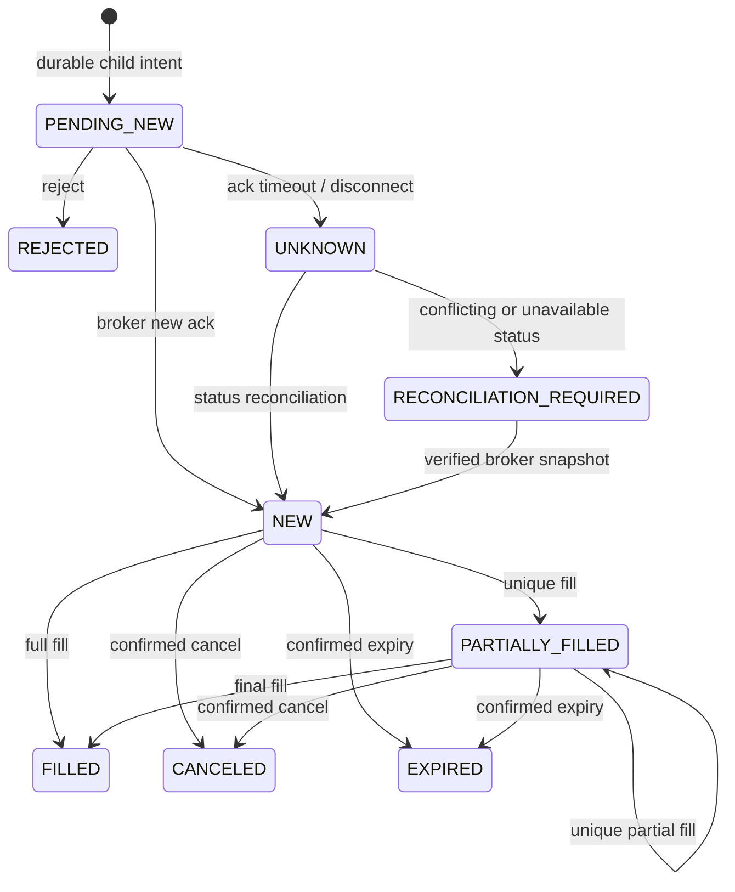

| Current order/request | Input | New state / action |
| --- | --- | --- |
| PENDING_NEW/NONE | New ack | NEW, bind brokerOrderId; duplicated identical ack is no-op |
| PENDING_NEW or UNKNOWN | unique fill | PARTIALLY_FILLED/FILLED; implicit accepted order, mark missing ack for review |
| NEW or PARTIALLY_FILLED | unique fill | add qty/notional once, recompute leaves, position/cash, reservation |
| NEW or PARTIALLY_FILLED | local cancel | same order state / PENDING_CANCEL; persist outbox; retain leaves exposure |
| any live / PENDING_CANCEL | fill | apply fill; pending cancel remains until confirm or order FILLED |
| live / PENDING_CANCEL | cancel confirmation | CANCELED if leaves canceled; release only confirmed residual; terminal if filled in race |
| live / PENDING_CANCEL | cancel reject | return request NONE; order remains live or requires reconciliation |
| live / NONE | replace request | PENDING_REPLACE with desired qty/price; old effective order remains authoritative |
| live / PENDING_REPLACE | replace ack | install new effective qty/price and ID chain after validating cumQty and exposure |
| any | stale/conflicting report or impossible quantity | quarantine report; RECONCILIATION_REQUIRED; no economic mutation |
| live | disconnect / ack timeout | UNKNOWN for unacknowledged submission; otherwise retain last known order state with broker connectivity flag |

`effectiveQty = cumQty + liveLeaves + canceledRemainder` for a terminal canceled order; for a live order `effectiveQty = cumQty + leavesQty`. A replacement changes effectiveQty, never cumQty; reject if replacement qty < cumQty, if `parentFilled + otherLiveOrUnknownLeaves + proposedNewLeaves > parentOriginalQty`, or if added risk cannot be reserved before dispatch. `avgPx = sum(fillQty * fillPrice)/cumQty` as a rational, displayed to 6 decimal USD; zero fills have null average. Parent `filled = sum(unique child fills) <= parent originalQty`; active child leaves plus filled plus planned-unsubmitted quantity cannot exceed parent quantity. Broker `CumQty`/`LeavesQty` are cross-checked against local totals, not blindly added. A correction/bust is **deferred**; such ExecType requires quarantine and manual reconciliation in MVP.

FIX `ExecType(150)` describes why an ExecutionReport was sent; `OrdStatus(39)` describes current status. They are separate, with FIX precedence nuances; do not infer a fill merely from OrdStatus=PartiallyFilled. Duplicate report ID or duplicate `(session, executionId)` with identical payload is a recorded no-op; same ID with differing economics is a conflict. Out-of-order sequence triggers a session gap and holds affected order as reconciliation-required until recovered. Late valid fills are processed if their execution ID is new and quantity fits; late replace ack must match the active request chain. Duplicate cancel request returns original result. Invalid transitions never mutate accounting; they generate a rejection/quarantine event and operator-visible reason. Broker disconnect blocks new dispatch for that session; restart rebuilds in-flight state and queries broker before resend. Phase 1 covers reducer transitions and duplicates; phase 3 covers real mock reports, races, unknown outcomes, and reconciliation; bust/correct and multi-day orders are phase 8 design work.

## 6. Durable journal and event sourcing

**Phase 1 choice: SQLite** in WAL mode, one writer connection, explicit transactions, `synchronous=FULL`, foreign keys on, busy timeout and bounded admission. SQLite's WAL is local storage; it is not an external broker transaction. A custom framed file WAL saves dependencies but adds recovery/index/snapshot complexity; PostgreSQL is justified only when multiple processes must write or remote operations are measured; snapshot+replay is a technique, not a standalone durable backend. Never add Kafka/Redis/Kubernetes without a measured requirement.

Tables proposed: `events(offset INTEGER PRIMARY KEY, event_id UNIQUE, type, schema_version, entity_id, event_time_ns, receive_utc, payload_json, payload_crc32c, prev_digest, digest)`, `outbox(outbox_id PRIMARY KEY, command_id, client_order_id, payload_json, state, attempts)`, `request_dedupe(scope, request_id, payload_hash, response_json)`, `snapshots(last_offset PRIMARY KEY, reducer_version, schema_version, state_blob, state_sha256, journal_digest)`. The committed event row and outbox intent share a local transaction. Offsets are contiguous; append computes next offset within the writer transaction. CRC32C detects accidental record corruption; SHA-256 chain and projection digest detect replay divergence, not adversarial tampering. Compute payload CRC32C over canonical payload bytes; compute each event digest over the canonical envelope excluding its own `digestSha256` field, concatenated with the previous digest. Verify before reduction. A persisted inbound input event precedes any derived decision it causes; a decision event includes the input offsets and reducer/scheduler version. Both records commit in one ordered transaction when part of the same sequencer step. `events` are never rewritten. Snapshot uses a temporary blob and commits a row only when full bytes/hash are ready; replay can discard a bad snapshot and start from genesis. No journal compaction in initial release. Retain full run artifacts; an operator may delete a whole archived run explicitly after export, never truncate an active journal.

**Atomic boundary:** (1) validate input and reserve risk in reducer proposal, (2) in one SQLite transaction append accepted events, request dedupe result, and outbox row, (3) after commit publish new in-memory projection, (4) dispatcher transmits, (5) reports are appended and reduced in later transactions. If commit fails, no business acknowledgment or dispatch. In-memory state is a cache of committed rows. Transaction commits are serialized. The broker's acceptance cannot be atomically committed with SQLite: use stable clientOrderId, at-least-once outbox attempt, broker dedup/status query, and quarantine unknown outcomes. Outbox state tracks `PENDING`, `ATTEMPTED`, `CONFIRMED`, `UNKNOWN`; retry `UNKNOWN` only after status reconciliation or idempotent broker proof.

| Crash window | Recovery |
| --- | --- |
| Before local commit | No accepted order; caller retries same requestId. |
| After commit, before transmission | Replay outbox; send same clientOrderId after broker status check if session status uncertain. |
| After transmission, before ack | Mark UNKNOWN; query by clientOrderId; never blindly mint a new ID. If query unavailable, halt affected order. |
| Ack received, before durable append | Broker replay/query restores report; hold until reconciled. |
| During snapshot | Ignore uncommitted or bad snapshot; replay earlier valid snapshot + journal. |
| Truncated/corrupt tail | SQLite integrity/schema/digest check fails closed; do not silently skip; restore verified backup or operator repair with recorded provenance. |

Startup validates DB integrity, schema versions, digest chain, snapshot anchor, replays tail, compares projection digest, then classifies pending outbox before dispatch. Read-only replay never writes or invokes adapters. Recovery tests kill a child process at named points and compare final projection, outbox and unique-fill sets to uninterrupted reference; repeat with fixed seeds. Disk-full, failed fsync, or DB corruption stops acceptance and dispatch, leaves an alert and recovery instructions. Exactly-once business effects require broker status/dedup semantics; where the mock cannot prove them, the order remains unknown.

## 7. Pre-trade risk gateway

All controls are **simulated**, not regulatory compliance. Config includes max parent/child shares, per-account gross outstanding notional, per-symbol concentration, buying power/credit, max open parents, data age, global kill switch, and algorithm pause. Initial BUY reserved exposure is `remaining shares * worst allowed limit price + worst-case fee`; SELL reserves shares against available long inventory and applicable cash/fee budget. No shorting in MVP. Price limit and quote freshness are checked before a new child; stale data rejects new dispatch and pauses schedule. For the MVP, BUY buying power requires `cashMicroUsd - reservedBuyMicroUsd >= 0` and `reservedBuyMicroUsd <= creditLimitMicroUsd`; gross exposure uses `abs(positionShares) * recordedRiskMarkMicroUsd + all live/unknown outstanding reservations`, with a recorded, freshness-checked risk mark and checked integer arithmetic. If the mark is stale or missing, new orders are rejected. A SELL requires unreserved long shares and does not assume short-sale proceeds fund a BUY. An account's remaining capacity is its configured limit minus that defined exposure. Existing cash/positions and the mark are run inputs, not inferred from telemetry.

The sequencer owns reservation mutation; two competing orders cannot both observe the same budget because validation and reservation events commit in one ordered transaction. Parent reservation is the budget envelope; child dispatch transfers part of that envelope to an identified child, rather than double counting. Filled quantity converts reserved exposure to position/cash exposure; unique fill reduces live leaves, but does not necessarily free total credit. Confirmed cancel/expiry/reject releases only the never-filled residual. A pending cancel and unknown acknowledgment retain their reservation. Replace increase requires incremental reservation **before** outbox commit; decrease releases only after replacement confirmation because old size may fill. Algorithm pause stops new children but not inbound reports; kill switch additionally requests cancellations and holds exposure until outcomes are confirmed. TTL-based reservation expiry is deferred because an unacknowledged broker order might still execute.

Invariants: accepted gross exposure <= configured capacity after every offset; every live/unknown child has sufficient reserved amount; reservations plus executed exposure reconcile to limits; no pending request frees risk. Race tests submit two concurrent commands at remaining capacity, fill during cancel, replace up/down across a fill, disconnect before ack, kill switch during outstanding orders. Reject reason and limit version are durable. Risk module must not depend on HTTP, Python, or telemetry.

## 8. Execution algorithms

Implement TWAP before VWAP. A schedule is a versioned pure function of recorded parent, clocks, market snapshot, fills, outstanding leaves, and policy. No schedule issues a child if paused, killed, stale, outside window, or price limit cannot be respected. `availableToSubmit = max(0, parentQty - totalFilled - sum(liveOrUnknownChildLeaves))`. Unknown leaves count at their worst effective quantity. Each decision records target, deficit, inputs, and proposed child quantity; replay recomputes and checks it.

**TWAP:** for Q shares, N equal-duration buckets, bucket k's cumulative target is `floor(Q*k/N)` for `k=0..N`; the final bucket reaches Q exactly, distributing remainders by floor differences. At tick k, `deficit = max(0, target(k) - filled - liveLeaves)`, `childQty = min(deficit, availableToSubmit, maxChildQty, riskCapacity)`. If ack is delayed, live/unknown leaves still occupy capacity. Policy `catchUp=bounded` allows later buckets to address deficit without violating max child or participation cap; end-of-window leaves can expire/cancel and unresolved residual is reported, never assumed filled. Every timer tick is durable.

**VWAP:** historical intraday volume estimates `v_i >= 0` for B buckets; `w_i = v_i/sum(v)` as exact rationals and `sum(w_i)=1`; reject zero total volume. Cumulative target at bucket k is `T_k = floor(Q * cumulativeWeight_k)` except final bucket `T_B=Q`. Scheduling deficit `D_k=max(0,T_k - filled - liveOrUnknownLeaves)`. Proposed size is `min(D_k, availableToSubmit, maxChildQty, floor(participationCap * observedOrExpectedBucketVolume))`; participation cap is rational, with a documented denominator. Actual participation `executedShares / observedMarketVolume` is undefined when denominator is zero. Completion is `filled == Q`, not `all children submitted`. A fill arriving late changes the next decision via recorded offset; it never rewrites an earlier decision. Cancel/replace counts old leaves until broker confirmation. Target curve estimates market *volume*, not future price returns; simulation cannot validate real-world optimality or impact.

**Illustration:** BUY 50,000 shares across five buckets with weights `[10,20,30,25,15]/100`; cumulative targets are 5,000, 15,000, 30,000, 42,500, 50,000. At bucket 3, if 9,000 are filled and 4,000 live, deficit is 17,000; with max child 5,000 and available 37,000, next child is at most 5,000, further constrained by risk/participation and price. A delayed fill of 2,000 lowers later deficits, not the already committed decision. Config and curve hash are journal inputs. POV, arrival-price, venue selection, smart routing, multi-venue and pairs execution are deferred phase 8 proposals.

## 9. Broker and venue simulation

Adapter interface (Java, framework-free): `submit(SubmitCommand)`, `cancel(CancelCommand)`, `replace(ReplaceCommand)`, `queryStatus(clientOrderId)`, `subscribeReports(cursor, consumer)`, `resynchronize(sessionCursor)`, `reconcileOutstanding(accountId)`. Commands carry `protocolVersion`, `commandId`, stable clientOrderId, account/symbol/side/qty/limit ticks, sessionId, traceparent optional. Results distinguish transport accepted, broker acknowledged, rejected, timed out, and unknown; transport accepted is never treated as broker acceptance. Reports carry broker session sequence and immutable economics. In-process mock implements this boundary first, with session and venue matcher as separate classes; a subprocess adapter may follow.

The seeded mock event heap supports configurable ack/fill latency, partial fills, rejects, duplicate/delayed/out-of-order reports, disconnect/reconnect, cancel/fill races, and in-flight restart snapshots. Persist scenario config, injected draws and resulting inbound events. The broker session owns client/broker ID mapping, report sequence, resend/status; venue owns matching and venue order IDs. OMS never reads venue internal book. Mock status query must return previously accepted client IDs after restart; if configured to lose status, OMS enters unknown/reconciliation-required. Backpressure rejects commands before acceptance or yields explicit unknown after transport; it never silently drops an accepted order.

FIX 4.4 is the protocol reference: NewOrderSingle `35=D`, ExecutionReport `35=8`, OrderCancelRequest `35=F`, OrderCancelReplaceRequest `35=G`, OrderCancelReject `35=9`; relevant fields include `ClOrdID(11)`, `OrigClOrdID(41)`, `OrderID(37)`, `ExecID(17)`, `ExecType(150)`, `OrdStatus(39)`, `CumQty(14)`, `LeavesQty(151)`, `LastQty(32)`, `LastPx(31)`, `OrderQty(38)`, `Price(44)`, `Side(54)`, `Symbol(55)`, `TransactTime(60)`. Validate required conditional fields and quantities against the official dictionary. Sequence gaps, resend requests and poss-dup flags are session concerns; a resend can repeat application messages, so economic dedup remains mandatory. QuickFIX/J is optional phase 8 only after mock contract tests; no custom dialect or live counterparty connectivity is planned.

## 10. MarketTwin integration boundary

Inspected MarketTwin's public README and architecture: its C++20 core owns synthetic matching, logical time, agents, accounting, and replay; its documented Python binding is coarse grained per run. It does **not** establish a per-child-order synchronous broker API for EXECUTRACE. Therefore no compatibility claim is made. EXECUTRACE retains PM intent, OMS, risk, scheduler, broker session, reservations, reconciliation, accounting, and diagnostics. MarketTwin may own an optional synthetic venue's matching, market time, and venue fills; those must not be copied into EXECUTRACE's MarketTwin adapter. The standalone mock remains the first demo's venue and is intentionally simple, not a duplicate research exchange.

Proposed extension: a new MarketTwin subprocess wrapper or socket endpoint with versioned length-prefixed JSON messages (`Submit`, `Cancel`, `Replace` only if supported, `MarketSnapshot`, `Ack`, `Fill`, `Reject`, `Status`, `Resume`). Each has request ID, client order ID, adapter sequence, simulated timestamp ns, instrument, integer shares and price ticks, and a schema version. Conversion between EXECUTRACE micro-USD ticks and MarketTwin's configured integer ticks MUST be exact or reject; no rounding. Venue events map to broker reports through a distinct broker-session adapter. Acknowledge acceptance only after the venue has a durable/replayable reference or mark the outcome unknown. Query/resume must prove no missed fill by a stable cursor; otherwise pause and reconcile manually. Bound socket queue; classify timeout as unknown, not reject. Test normal/partial/cancel/duplicate/restart/gap, conversion extremes, ordering and replay against standalone contract fixtures. A new MarketTwin per-event API, persistent session cursor, or wrapper changes are future work requiring separate review. AegisFeed normalization and IRONBUS transport are independent optional adapters; neither replaces the journal.

## 11. Accounting and reconciliation

The accounting reducer applies **unique** fills in journal order. BUY: position `+qty`, cash `-(qty*price + fee)`; SELL: position `-qty`, cash `+(qty*price - fee)`. MVP SELL cannot reduce inventory below zero. `executedNotionalMicroUsd=sum(qty*price)` with checked arithmetic; parent VWAP uses all unique child fills. Cost basis is weighted average for long positions: a BUY increases total cost by trade notional plus fee; a SELL removes proportional historical cost using a rational accumulator and books `proceeds - removed cost` as realized simulated P&L. Unallocated rounding remainder stays in cost until flat, when cost MUST be zero. Unrealized P&L requires an explicit recorded mark and is deferred. Initial cash is an immutable run input, and each fill's fee schedule/version is recorded. Pending exposure is reserved, not cash-settled. No actual settlement, tax lots, or corporate action processing.

Local projection and broker-reported state are separate. On reconnect/restart, request broker snapshot and report cursor; join by stable client/broker IDs, compare cumulative quantity, leaves, status, and unique execution IDs. Missing fill: query/resend and apply only after report validation. Extra local fill: quarantine order and investigate broker correction; never delete it silently. Status mismatch: hold dispatch and expose discrepancy with both source values and offsets. If broker cannot enumerate executions, completeness is unprovable; mark `RECONCILIATION_REQUIRED`. A correction is an explicit compensating event with prior execution reference in a future phase, never mutation of history. Replay of the same events MUST reproduce positions and cash exactly; reconciliation result itself is an event so later decisions see the same hold state. Operator view lists unresolved count, age, and affected accounts without high-cardinality metrics.

## 12. Execution quality and TCA

All calculations label benchmark provenance and missing-data reason. Let `Q` parent shares, `F` unique filled shares, `p_j` fill tick price, `q_j` fill shares, `M_j` market volume, `t0` durable acceptance time, `tF` final fill time. Prices remain integer/rational until display.

| Measure | Formula / unit | Missing policy |
| --- | --- | --- |
| Completion | `F/Q`, percent | never missing for accepted Q>0 |
| Parent execution VWAP | `sum(q_j*p_j)/F`, micro-USD/share | null when F=0 |
| Average child fill price | per-child `sum(q*p)/childFilled`, micro-USD/share | null for unfilled child |
| Arrival slippage | BUY: `(execVWAP-arrivalPrice)/arrivalPrice*10,000` bps; SELL reverses sign | null if recorded arrival quote absent/stale |
| Reference VWAP deviation | side-adjusted `(execVWAP-referenceVWAP)/referenceVWAP*10,000` bps | null if reference market price-volume observations incomplete |
| Simplified implementation shortfall | BUY: `sum(q_j*(p_j-arrivalPrice)) + (Q-F)*(terminalMark-arrivalPrice) + fees`, micro-USD; SELL signs reverse | null if arrival or terminal mark absent; display filled/unfilled components |
| Participation | `F / sum(M_j)` over matching window, percent | null for zero/missing market volume |
| Time to complete | `tF-t0`, simulated ms | null unless F=Q |
| Fill ratio | `F / sum(accepted child effective quantities net of confirmed replace reductions)`, percent | null if denominator zero; disclose denominator |
| Reject/cancel rates | count confirmed rejected/canceled children / submitted children | zero denominator -> null |

Reference VWAP is market-data benchmark, not the order's fill VWAP. Synthetic volume and price paths yield **simulated execution measurements**, not evidence of observed market performance. Market impact assumptions are uncalibrated until independently evaluated. TCA is a read-only projection; it never feeds risk in MVP.

## 13. Observability contract

Business events in SQLite are authoritative; metrics, logs, traces, JFR recordings, and incident records are best effort. OTel context is captured at API acceptance, carried explicitly with command/outbox envelopes and async callbacks, and restored for child spans; HTTP uses W3C `traceparent`. Broker adapter messages include optional trace context; absence starts a linked trace with correlation metadata. Python receives trace IDs in read-only evidence references, not as proof of business order. Each span can contain order IDs as **attributes** under controlled retention, but metrics never label them. Structured logs include timestamp, level, component, operation, event offset, trace ID, sanitized error code, and optional hashed order reference; no raw order payloads or secrets.

| Instrument | Type, unit | Allowed labels; purpose |
| --- | --- | --- |
| `executrace_orders_accepted_total` | counter, orders | `side`, `algorithm`, `result`; ingress |
| `executrace_execution_reports_total` | counter, reports | `exec_type`, `result`, `adapter`; duplicates/errors |
| `executrace_risk_rejections_total` | counter, decisions | `reason`, `scope`; controls |
| `executrace_journal_append_seconds` | histogram, seconds | `event_class`, `result`; durable commit cost |
| `executrace_oms_process_seconds` | histogram, seconds | `event_class`; reducer cost |
| `executrace_risk_validate_seconds` | histogram, seconds | `decision`; validation cost |
| `executrace_scheduler_decision_seconds` | histogram, seconds | `algorithm`; schedule cost |
| `executrace_broker_ack_seconds` | histogram, seconds | `adapter`, `outcome`; dispatch to ack |
| `executrace_order_accept_seconds` | histogram, seconds | `source`, `result`; API-to-commit |
| `executrace_queue_depth` | gauge, messages | `queue`; backpressure |
| `executrace_messages_total` | counter, messages | `source`, `type`, `result`; rates/retries |
| `executrace_payload_bytes` | histogram, bytes | `boundary`, `message_type`; size shifts |
| `executrace_timeouts_total` | counter, timeouts | `boundary`; failures |
| `executrace_telemetry_dropped_total` | counter, records | `signal`, `reason`; loss visibility |
| JVM standard memory/GC/thread metrics | gauge/counter/histogram as exported | process/service labels only; correlate pauses/contention |

Allowlist finite enum values; reject dynamic account, symbol, order, execution, request, incident, trace, raw exception text, URL path, or client IDs as Prometheus labels. `service.name`, `deployment.environment`, operation, result, and bounded adapter type are safe. Spans: `order.accept`, `risk.reserve`, `schedule.decide`, `journal.commit`, `outbox.dispatch`, `broker.submit`, `broker.report`, `oms.apply`, `reconcile.compare`, `diagnostics.detect`, `incident.retrieve`. Record bounded attributes (`event.type`, `offset`, `result`, `algorithm`, trace/order correlation on sampled spans); never full FIX messages or potentially sensitive payload. HTTP and broker boundary spans should link retries to original attempt. Metrics are aggregate rates/distributions; logs give discrete context; traces connect causally related calls; journal reconstructs business facts.

Use OTel SDK bounded batch buffers, asynchronous exporter and short timeout. On full buffer drop telemetry and increment a local dropped counter; no exporter callback enters sequencer. If collector unavailable, execution remains functional and drop count rises. Head sampling can retain 100% during small local demos, then configurable lower rate; error/fault traces may use a bounded tail-sampling policy at Collector later. Sampling must not affect journal. Retention defaults: local experiment artifacts explicit, operational metrics/traces configurable and ephemeral. Redact input at source. A dashboard shows dependency edges (API→sequencer→broker; detector reads collector), queue depth, ack tail latency, retries, report duplicates, GC pauses and drop counts; a demo must prove a shared trace ID through a child lifecycle without claiming every event sampled.

## 14. Deterministic anomaly detection

Python 3.12+ consumes bounded 10-second windows exported from telemetry; baseline warmup requires at least 30 normal windows per `(service,operation,workloadBucket)` before scored alerts. A workload bucket is a coarse accepted-order-rate band, not an ID. No baseline updates while a confirmed fault window is active. Missing data produces `INSUFFICIENT_DATA`, not normal. A zero-traffic window is valid only if exporter heartbeat exists. Use sorted input windows and versioned detector configuration for deterministic output.

For signal `x_t`, EWMA `m_t=alpha*x_t+(1-alpha)*m_(t-1)` with alpha=0.2 default; robust score `z_t=|x_t-median(W)| / max(1.4826*MAD(W), epsilon)` on a rolling 30-window baseline. Rate signals normalize by accepted order count or use a Poisson-style expected count with exposure seconds; tail latency uses p95/p99 with minimum sample count 30; payload size uses p95 and median; queue growth uses slope plus absolute depth. Quantile threshold can complement MAD for skewed distributions. The initial alert candidate requires `z>=4` **and** an absolute minimum effect (e.g. 2x normalized rate or +20 ms p95, configurable); 2 consecutive scored windows open an alert, 3 normal windows close it. Suppress duplicate alerts per signal/service for 5 minutes while retaining observations. Correlate alerts within 60 seconds by shared service/trace dependency graph; report separate candidates when evidence does not connect them. Confidence is calibrated from held-out scenarios, not a model's subjective number. Thresholds are design defaults to tune against false positives; a normal market-volume surge can raise raw RPC count without abnormal calls/order.

```text
for window in ordered_windows:
  if no heartbeat or sample_count below minimum: emit INSUFFICIENT_DATA; continue
  key = (service, operation, workload_bucket, signal)
  baseline = prior_normal_windows[key]
  if len(baseline) < 30: emit WARMING_UP; update_if_normal(window); continue
  score = robust_score(window, baseline)
  candidate = score >= threshold and effect_size >= minimum
  update_hysteresis(key, candidate)
  if opened: emit versioned Anomaly with evidence window IDs
  if not candidate and no active fault: update baseline with bounded outlier policy
```

Schema: `{schemaVersion, anomalyId, detectorVersion, service, operation, signal, windowStartUtc, windowEndUtc, observedValue, unit, baselineMedian, baselineMad, normalizedScore, workloadBucket, severity, status, evidenceRefs, missingTelemetryFraction}`. Signals include RPC/retry volume, payload size, tail latency, queue growth/stall, timeout/error rate, CPU/GC, broker ack delay, data staleness, risk rejection spike. Evaluate on held-out seeds/scenarios with alert delay, precision/recall, and false positives per normal hour. Isolation Forest/change-point methods are optional phase 8 only after baseline errors are characterized. An LLM is not the anomaly detector.

## 15. AI-assisted incident investigation

The default pipeline is deterministic: receive anomaly, fetch bounded metrics/windows, sampled traces/logs, topology and read-only journal references by time/service/trace, build a timeline ordered by timestamp then source ID, rank cause hypotheses from explicit rules, and emit a typed report. Evidence retrieval has a hard horizon (e.g. 15 minutes before to 5 minutes after), max 200 spans, 200 log records, 50 journal references and 5 seconds per source; truncation is recorded. It never fetches hidden `FaultScenario.expectedCause`. Journal references may prove an order was affected but are not writable. Log text is untrusted evidence, quoted/redacted as data; any instructions embedded in it are ignored.

```json
{"schemaVersion":1,"incidentId":"uuid","affectedServices":["broker-session"],"affectedOrders":["opaque-order-ref"],"onsetTimeUtc":"2026-11-05T14:30:00Z","symptomSummary":"ack delay rose","candidateCauses":[{"cause":"broker retry storm","confidence":0.71,"supportingEvidence":["metric:window-42","trace:abc/span-3"],"contradictingEvidence":["metric:window-41"]}],"missingEvidence":["unsampled broker spans"],"recommendedNextChecks":["inspect broker reconnect count"],"knownGroundTruthForEvaluationOnly":null}
```

A model-agnostic optional provider receives **curated evidence only**, a strict JSON schema, explicit uncertainty instructions, no business-write tools, max token/tool/time budget, and no secrets. Validate JSON types, confidence `[0,1]`, evidence IDs against retrieved set, and absence of unsupported order/price claims. Invalid, timed-out or unavailable model output falls back to deterministic report with reason. Prompt injection tests put commands inside logs and verify no tool call or order mutation. AI output cannot submit/cancel/replace, approve risk, or set authoritative state. Keys are optional and never required by execution, CI, or core tests. Evaluate cause ranking against hidden ground truth only after report generation; measure citation validity, unsupported claims and calibration.

## 16. Reproducible fault injection catalog

Every fault has `(scenarioId, seed, triggerOffset|simulatedTime, injectionPoint, action)` in the run manifest; the injected *inputs and observed effects* are journaled where they affect business state. Expected cause is separate, hidden from the investigator. Test-command syntax below is **planned**, not available. All scenarios assert applicable invariants in §17. `fault-run <ID> --seed 17 --verify` denotes a phase-local command to implement. A scenario passes only when business result, telemetry/anomaly (where expected), explanation/evidence (where phase 6 applies), and recovery match the row. An anomaly marked `none` is an intentional negative control, not a missing test.

| ID / phase | Injection and trigger | Business outcome / recovery | Telemetry → anomaly → incident expectation | Pass criterion and planned command |
| --- | --- | --- | --- | --- |
| F01 / 3 | broker duplicates fill report at offset | one economic fill; dedupe persisted on restart | duplicate counter; detector may not alert for one duplicate; report cites if correlated | one position/cash delta; `fault-run F01 --seed 17 --verify` |
| F02 / 3 | drop new ack after broker accepts | UNKNOWN, status query binds same client ID | ack timeout → delay alert → missing-ack hypothesis | no second broker order |
| F03 / 3 | disconnect with in-flight child | hold reservation, reconnect/query | disconnect and queue → service alert → broker outage | no oversubmit after restart |
| F04 / 3 | fill before cancel ack | apply fill, release confirmed residual only | cancel latency/fill trace → optional race report | cum+released+leaves consistent |
| F05 / 3 | delay report by two ticks | preserve offset order, later scheduling adjusts | report latency → tail alert → delayed report | no historical schedule rewrite |
| F06 / 1 | inject illegal transition | quarantine, no accounting mutation | validation error → optional alert → invalid report | state digest unchanged except quarantine |
| F07 / 3 | kill after journal commit | replay event/outbox, query then dispatch | restart gap → stall alert → crash timeline | same final digest as reference |
| F08 / 3 | kill before transmission | pending outbox replay and safe send | dispatch delay → optional alert → outbox backlog | one broker client ID |
| F09 / 3 | kill after send before ack | UNKNOWN and query; no blind resend | timeout → alert → unknown outcome | no double economic effect |
| F10 / 1 | truncate/corrupt journal copy | fail closed, restore known-good backup | startup integrity error → alert → corruption | never skip bad row |
| F11 / 5 | risk-call retry multiplier 5x | risk remains serialized/idempotent | normalized RPC rate → alert → retry storm | evidence links repeated calls |
| F12 / 5 | enlarge payload 8x | reject oversize or process bounded | payload p95 → alert → size growth | bound enforced, cited distribution |
| F13 / 2 | market data age beyond limit | pause child dispatch, retain parent | freshness gauge → alert → stale data | no stale-price child |
| F14 / 4 | stall telemetry consumer | trading continues; bounded drops | queue/drops → alert → slow consumer | no sequencer block |
| F15 / 4 | collector unavailable | trading continues | dropped counter / heartbeat missing → data-quality alert → collector outage | identical business digest |
| F16 / 4 | induced JVM GC pause | business correct; latency rises | JFR pause + p99 → alert → GC hypothesis | JFR evidence cited, no latency guarantee |
| F17 / 6 | diagnostic provider timeout | deterministic report fallback | provider timeout → optional alert → missing model evidence | no order state effect |
| F18 / 3 | broker sequence 12 before 11 | hold/reconcile, process only verified sequence | gap counter → alert → report ordering | no missing fill counted twice |
| F19 / 2 | two account orders race at limit | one or both rejected to fit budget | risk rejection → workload-aware alert optional | never exceed limit |
| F20 / 1 | corrupt snapshot copy | discard snapshot, replay from valid prefix | recovery warning → optional alert → snapshot failure | digest matches genesis replay |

For F02/F03/F09, the mock status endpoint is expected to recover; a separate variant makes it unavailable and expects unresolved `RECONCILIATION_REQUIRED`, not a fabricated success. F11–F17 are operational tests, and detector/report gates apply only after phases 5–6. The full scenario record contains exact trigger, first violating offset if any, and replayable inputs.

## 17. Correctness invariant catalog

Detection runs after each committed reducer step in tests and at selected production assertions; a violation stops dispatch for affected account/session and records a durable fault if storage works. Test fixtures cite invariant IDs and phase. `P1` etc. mean phase first enforced; later phases keep the gate.

| ID / phase | Definition and enforcement point | Test / detection / fail-safe |
| --- | --- | --- |
| INV-001 P2 | `filled + live/unknown child leaves <= parentQty`; scheduler and OMS | property sequence and race; halt parent on breach |
| INV-002 P1 | `(brokerSession,executionId)` contributes once; fill reducer | duplicate/collision test; collision quarantined |
| INV-003 P1 | child cumQty <= effectiveQty; OMS | random fills/replaces; quarantine conflicting report |
| INV-004 P2 | pending cancel retains residual exposure; risk reducer | F04; hold reservation |
| INV-005 P1 | same snapshot+events+reducer version gives same digest; replay | golden/property replay; fail closed |
| INV-006 P1 | replay emits zero outbound calls; dispatcher gate | spy adapter test; abort replay if called |
| INV-007 P1 | committed journal offsets increase contiguously; journal | recovery scan; stop startup |
| INV-008 P2 | every accepted live child has accounted reservation; risk projection | account ledger reconciliation; pause account |
| INV-009 P4 | collector availability cannot change business digest; telemetry boundary | F15 paired run; isolate exporter |
| INV-010 P6 | AI output cannot modify order/risk; API capabilities | prompt injection test; reject write invocation |
| INV-011 P1 | each child belongs to one parent and has immutable origin; OMS | schema/property test; reject command |
| INV-012 P1 | confirmed fill qty/price positive and tick-aligned; report validation | malformed report fuzz; quarantine |
| INV-013 P2 | committed risk exposure <= configured account/symbol limit; transaction | F19 concurrent requests; reject excess |
| INV-014 P3 | positions/cash equal unique-fill ledger; accounting | replay and independent reference sum; pause account |
| INV-015 P3 | unknown broker outcome cannot create new clientOrderId on retry; dispatcher | F02/F09; hold and query |
| INV-016 P1 | requestId with changed payload never aliases original response; dedupe table | retry test; 409 |
| INV-017 P1 | outbox command has committed originating event; transaction | kill-point test; stop orphan dispatch |
| INV-018 P3 | confirmed cancel releases only broker-confirmed unfilled leaves; risk | F04 + cancel reject; hold exposure |
| INV-019 P2 | no schedule decision reads unrecorded clock/curve/quote/random input; scheduler | replay mutation tests; reject missing input |
| INV-020 P3 | broker reconciliation discrepancies remain visible until explicit resolution | mismatch test; block affected order |
| INV-021 P1 | arithmetic overflow cannot wrap quantity/notional/cash | boundary tests; reject/quarantine |
| INV-022 P3 | no accepted child sent twice with distinct broker identity by recovery | crash-window tests; UNKNOWN if unprovable |
| INV-023 P4 | metric label values are bounded allowlists | instrumentation tests; drop invalid metric |
| INV-024 P6 | every cited evidence ID exists in retrieved bundle | report validator; deterministic fallback |
| INV-025 P3 | parent fill total equals sum of unique child fills | property/replay test; pause parent |
| INV-026 P1 | unsupported schema or corrupt journal is never silently skipped | fixture tests; stop startup |

These guarantees are bounded by the assumptions in §0; they do not assert fault tolerance to arbitrary hardware loss or an uncooperative external broker.

## 18. Concurrency and performance

Initial Java model: HTTP and broker callbacks validate/normalize on bounded producer threads, enqueue immutable commands, and one writer owns all OMS, risk, schedule, accounting and journal state. A bounded dispatcher reads committed outbox on another thread; it may retry but never mutate reducer state directly. Account risk is serialized through this writer, eliminating multi-lock budget races. Immutable snapshots serve read APIs via atomic publication after commit. Queue capacity is configured; producers time out and receive explicit rejection/backpressure before durable acceptance. Reports already accepted by broker but unable to enqueue require broker resend/query on recovery; the adapter must not acknowledge them prematurely. No shared mutable OMS maps outside writer.

Java 21 provides mature concurrency and profiling; object allocation/GC pauses and OS thread scheduling are real. Start with simple records and G1 default, measure JFR allocation, safepoints and pauses; choose another GC or lower allocation only after evidence. Avoid object pooling until retention and correctness costs are understood. Pad hot counters only if false sharing appears in profiles. Thread affinity requires Linux experiment evidence, not a design assumption. Scale beyond one writer only when measured writer saturation persists after reducing avoidable work; partition by independent account/session with explicit cross-account limits and ordered merge semantics in a new ADR. Extra threads can worsen tail latency and replay complexity.

Separate producer-to-consumer enqueue latency, journal append/commit, reducer processing, parent scheduling, simulated broker ack/fill, and end-to-end acceptance-to-fill. Benchmarks: fixed workload config/seed, 30-second warmup, at least five 60-second measurement runs and >=10,000 samples for hot-path distributions when possible; report p50/p95/p99/p99.9 with sample counts, throughput, CPU, RSS/heap, allocation rate, GC pauses, queue high-water, OS/CPU architecture, storage, JDK/flags, source SHA, load generator and run-to-run median/range. Adjust sample duration based on achieved rate; do not report p99.9 from insufficient samples. JMH measures isolated reducer/scheduler/journal methods only; end-to-end harness measures ingress through reconciliation and includes simulated broker delay. Native Linux x86-64 measurements are distinct from macOS functional tests, Docker functional tests, or Apple Silicon emulation. Any numeric objective remains a **DESIGN GOAL** until artifacts exist.

## 19. Storage, schemas, and artifacts

Authoritative representation is the SQLite event stream with canonical UTF-8 JSON payloads (stable key order, integer numeric fields, no NaN, explicit UTC ISO-8601 and nanosecond fields). JSON is chosen for early auditability; Protobuf may become a versioned adapter wire format later. Projections are disposable caches; snapshots accelerate replay but cannot override journal truth. Telemetry goes to optional collector/Prometheus/Tempo or local NDJSON fixtures; incident records are versioned JSON artifacts. Experiment artifacts include manifest, scenario config, event export, projection digest, invariant report, metrics/traces, incident report, and checksums. Write to temporary run directory, fsync files as appropriate, then atomic rename a `COMPLETED` manifest; incomplete runs stay explicitly marked.

Example authoritative event envelope:
```json
{"schemaVersion":1,"eventId":"0dd57a90-6bd2-4a4d-bf34-72ed492ab08d","sequencerOffset":42,"eventType":"FillApplied","entityType":"ChildOrder","entityId":"2f7628c2-a9a5-4259-aa34-5606ef5cfce7","eventTimeNs":1200000000,"receiveTimeUtc":"2026-11-05T14:30:01Z","processingTimeUtc":"2026-11-05T14:30:01Z","correlationId":"5dd02717-10ba-4f61-bc8b-61e7e58ccbfb","payload":{"brokerSessionId":"mock-1","executionId":"E17","quantityShares":2500,"priceMicroUsd":185250000,"feeMicroUsd":125000},"payloadCrc32c":"8hex","previousDigestSha256":"64hex","digestSha256":"64hex"}
```
The CRC/digest strings above are schema placeholders, not computed checksums; fixtures MUST use actual values. Snapshot contains `{schemaVersion,reducerVersion,lastOffset,journalDigestSha256,stateSha256,state}` and is valid only against that offset. Malformed/unknown required fields fail closed. Minor additive unknown fields may be retained; semantic changes require new major schema/reducer version and replay migration/golden tests. Signed events and encryption at rest are deferred; checksums detect corruption, not a hostile writer.

## 20. Control APIs and adapter interfaces

HTTP is a control/read layer; core records do not import HTTP types. Local-only bind (`127.0.0.1`), single operator token if exposed outside loopback later, 1 MiB max body, max 20 requests/s per local client by default, bounded queue/timeout. All mutation responses include `requestId`, `sequencerOffset` if committed, status, and stable resource ID. Validation errors `400/422`; duplicate key with changed payload `409`; risk rejection `422` with code; backpressure `429`; degraded journal `503`; unknown broker state `202` with explicit status; not found `404`. No endpoint implies final fill on acceptance. Proposed schema shorthand below uses types from §3; all endpoints are **planned**, never asserted live.

| Endpoint / phase | Request → response | Idempotency, validation, concurrency |
| --- | --- | --- |
| `POST /api/v1/orders` / P3 | `{requestId,accountId,symbol,side,quantityShares,limitPriceMicroUsd,algorithm,window,curveId?}` → `{parentOrderId,status,offset}` | requestId required, exact decimal/tick checks, serialized risk; 202/409/422/429/503 |
| `GET /api/v1/orders/{id}` / P3 | path UUID → parent+children, revisions, filled/leaves/unknown | read immutable published projection; 200/404 |
| `POST /api/v1/orders/{id}/cancel` / P3 | `{requestId,expectedRevision}` → `{requestStatus,offset}` | dedup; 202 pending, 409 stale revision, 404/422/429/503 |
| `GET /api/v1/orders/{id}/executions` / P3 | path UUID, bounded cursor/limit<=500 → unique fills+next cursor | stable offset pagination; 200/404/400 |
| `GET /api/v1/accounts/{id}/risk` / P2 | account UUID → limits, reserved, available, version | consistent snapshot offset; 200/404 |
| `GET /api/v1/positions` / P3 | accountId required, cursor/limit → position/cash projection | read-only; 200/400 |
| `POST /api/v1/simulations` / P3 | `{requestId,scenarioId,seed,configVersion}` → `{runId,status}` | one run per key; bounded active runs; 202/409/422/429 |
| `GET /api/v1/simulations/{id}` / P3 | run UUID → status, manifest link, digest if complete | 200/404 |
| `POST /api/v1/replay/verify` / P3 | `{requestId,runId,expectedDigest?}` → `{verificationId,status}` | read-only replay job, never dispatch; 202/404/409/429 |
| `GET /api/v1/incidents` / P6 | time/service/status filters, cursor/limit<=100 → summaries | read-only, bounded; 200/400 |
| `GET /api/v1/incidents/{id}` / P6 | UUID → typed report + evidence refs | 200/404 |

Replace control API (`POST /api/v1/orders/{id}/replace`) is phase 3 and uses `{requestId,expectedRevision,newQuantityShares,newLimitPriceMicroUsd}`; it requires reserve-before-send and returns pending request state. Internal command interface is `CommandEnvelope(version, requestId, source, recordedInput, correlation)` → sequencer result; broker interface is §9; anomaly schema is §14. HTTP must never call the reducer out of sequence. Rate limits protect local resources, not a claim of Internet-ready auth.

## 21. Security and safety

Default configuration is simulation-only and loopback-only. No real broker connector, live order credentials, remote execution target, or LLM write tool exists in initial releases. Input parser enforces body/string/array limits, enum and schema validation, tick/quantity/range checks, safe path handling, and bounded queues/timeouts. Journal corruption, unsupported schema, unknown broker outcome, risk inconsistency, or overflow fails closed for affected account/session. Secrets, when an optional LLM provider exists, come from environment/OS secret store and never appear in repo, traces, payload examples, or logs. Redact account identifiers and financial payloads from external telemetry; treat logs and broker text as untrusted input, including prompt injection attempts. Pin Gradle dependencies, Python lockfile and native toolchain versions when introduced; scan dependencies in CI. Explicit opt-in and a new ADR would be required even to consider any live connectivity, and this design does not specify it.

## 22. Planned monorepo structure and dependency direction

Existing placeholder directories are not implementation. Add only the files needed by a phase; the tree below is a plan, not a claim of current contents.

```text
execution-core/             Java Gradle modules: domain, sequencer, OMS, journal, scheduler (P1–2)
risk-engine/                Java library; pure risk rules/reservations (P2)
broker-simulator/           Java broker session, mock venue, fixtures (P3)
execution-app/              Java local CLI/control API and composition root (P3)
observability/              OTel config/instrumentation dashboards (P4)
ai-diagnostics/             Python detector, evidence retrieval, reports, evaluation (P5–6)
adapters/markettwin/        optional Java/socket + C++ wrapper (P8)
adapters/aegisfeed/         optional market-data normalization (P8)
adapters/ironbus/           optional Linux-only C++ transport experiment (P8)
schemas/                    versioned JSON schemas and fixtures (P1)
tests/                      multi-module process/fault/end-to-end harnesses (P1–7)
benchmarks/                 JMH and end-to-end runners/artifact format (P7)
configs/                    versioned simulated risk/curve/scenarios (P2)
infra/                      optional Compose/Collector/Prometheus/Tempo (P4)
scripts/                    verified repeatable test/demo commands (P1–7)
docs/adr/                   decision amendments (when needed)
research/                   benchmark and evaluation reports, no runtime dependency (P7)
```

`domain <- risk/OMS/scheduler <- execution-app`; broker adapter interfaces are defined in domain/core and implemented by simulator/optional adapters; observability wraps calls but does not feed domain; Python reads exports only. `execution-core` may depend on JDK, SQLite driver at persistence edge, and test libraries in tests, not Spring/HTTP/OTel SDK/Python/native code. `risk-engine` depends on domain records, not broker internals. `broker-simulator` may depend on adapter contracts, not OMS mutable internals. `ai-diagnostics` has no business write dependency. `adapters/ironbus` is Linux x86-64 only; macOS correctness uses socket/mock. AegisFeed and MarketTwin remain external repositories. Avoid both one giant module and service-per-class fragmentation.

## 23. Phased implementation plan

**Phase status:** phases 0–8 are **PLANNED — NOT IMPLEMENTED**; writing this document establishes the proposed Phase 0 design text only. A phase is complete when its evidence gate passes, not when files compile. The first end-to-end order demo is the critical path P1→P2→P3; P4→P5→P6 add operations/AI; P7 hardens. A focused 2–3 week initial release can narrow symbols, accounts, and UI while retaining the core gates. If time slips, complete P1–P3 plus replay/cancel/duplicate demos, then P4 minimal telemetry and P5 deterministic alert; defer optional LLM and all P8 integrations. No estimated coding-hour claim is a correctness criterion.

Each phase below is one acceptance **stage** with ordered sub-stages. The numbered fields are mandatory handoff instructions for an implementation agent; file names are planned locations, not current files.

### Phase 0 — architecture and repository foundation — PLANNED, NOT IMPLEMENTED

1. **Objective:** make contracts and build conventions executable without changing semantics.
2. **Scope/sub-stages:** (0a) schema/invariant review, (0b) Java toolchain/Gradle locking, (0c) deterministic fixture and ADR conventions.
3. **Files/modules:** `schemas/`, Gradle root/settings/wrapper, `docs/adr/` only as needed; this documentation remains source of truth.
4. **Design:** Java 21 toolchain, locked dependency resolution, versioned fixture loader, seed/run manifest; prohibit implicit wall clock in reducers.
5. **Dependencies:** none beyond approved architecture and JDK.
6. **Order:** validate schema examples → establish toolchain → add fixture checker → CI.
7. **APIs/schemas:** event envelope v1, identifiers/units, `RunManifestV1`; no public HTTP yet.
8. **State/invariants:** INV-007/016/021/026 definitions become executable fixture checks.
9. **Unit tests:** malformed/unknown schema, numeric boundaries, canonical JSON.
10. **Integration tests:** fresh macOS/Linux checkout resolves locked Gradle deps and fixtures.
11. **Failure tests:** unsupported major version and corrupt fixture fail with named reason.
12. **Performance tests:** none; no benchmark claims.
13. **Evidence:** CI logs, dependency lock, schema validation report, fixture digests.
14. **Acceptance:** no source module depends on HTTP/OTel/AI; schema roundtrip exact; CI green on supported hosts.
15. **Done:** instructions run from clean checkout and generated artifacts are reproducible.
16. **Non-goals:** OMS, broker, Docker, optional adapters.
17. **Risks:** changing schema too early; use small golden fixtures and ADRs.
18. **Learning:** Gradle toolchains, deterministic serialization, architectural authority.
19. **Explain without AI:** why units/versioning/IDs constrain future replay.

### Phase 1 — authoritative lifecycle — PLANNED, NOT IMPLEMENTED

1. **Objective:** durable parent/child reducer with replay and economic idempotency.
2. **Scope/sub-stages:** (1a) domain/numeric types, (1b) single writer and transition reducer, (1c) SQLite journal/outbox/snapshot, (1d) property/reference tests.
3. **Files/modules:** `execution-core/domain`, `execution-core/oms`, `execution-core/journal`, `schemas/`, `tests/`.
4. **Design:** one writer commits immutable event batches; reducer has no IO/time; cache publishes after commit; replay suppresses side effects.
5. **Dependencies:** P0 schema/toolchain.
6. **Order:** types → independent reference model → reducer → journal → replay → crash fixtures.
7. **APIs/schemas:** `CommandEnvelopeV1`, `JournalEventV1`, `SnapshotV1`, child transition table, request dedupe API.
8. **State/invariants:** INV-002/003/005/006/007/011/012/016/017/021/026.
9. **Unit tests:** every legal/illegal transition, duplicate key/payload conflict, overflow and equality boundaries.
10. **Integration tests:** SQLite append/reopen/replay yields identical canonical digest; snapshot and genesis replay agree.
11. **Failure tests:** kill before/after commit, corrupt snapshot/tail, F06/F10/F20; no silent skipping.
12. **Performance tests:** collect unoptimized append/reducer distributions as baseline only.
13. **Evidence:** transition coverage table, property seeds, journal/replay digests, first failing offset on failures.
14. **Acceptance:** 10,000 seeded random operations across >=20 seeds produce no invariant violation; duplicate fill contributes once; replay sends zero outbound calls.
15. **Done:** clean restart yields same state and all P1 invariants pass.
16. **Non-goals:** broker network, algorithm, risk sophistication, FIX.
17. **Risks:** database transaction vs cache divergence; publish only post-commit.
18. **Learning:** Java records/memory model, event sourcing, SQLite transactions, reference models.
19. **Explain without AI:** why an event log alone does not make unrecorded decisions deterministic.

### Phase 2 — risk and execution algorithms — PLANNED, NOT IMPLEMENTED

1. **Objective:** enforce capacity and create safe TWAP/VWAP child intents.
2. **Scope/sub-stages:** (2a) account/child reservations and kill switch, (2b) TWAP, (2c) volume-curve VWAP, (2d) delayed-fill/replace scheduling tests.
3. **Files/modules:** `risk-engine/`, `execution-core/scheduler`, `configs/curves`, `tests/`.
4. **Design:** serialized risk under writer; parent envelope transfers to children; pure schedule decision with recorded tick/curve/quote.
5. **Dependencies:** P1 durable lifecycle and numeric type.
6. **Order:** risk ledger → capacity races → TWAP → VWAP → price/freshness gates.
7. **APIs/schemas:** `RiskLimitV1`, `ReservationEventV1`, `ScheduleTickV1`, `VolumeCurveV1`, `ScheduleDecisionV1`.
8. **State/invariants:** INV-001/004/008/013/019 plus P1 invariants.
9. **Unit tests:** exact 50,000-share curve targets, remainder distribution, stale quote, kill/pause, oversubmit limits.
10. **Integration tests:** two parents compete for capacity; scheduler survives replay and late fills.
11. **Failure tests:** F13/F19, fill while pending cancel, replace increase/decrease and unknown ack.
12. **Performance tests:** JMH isolated decision plus end-to-end schedule latency baseline, labeled separately.
13. **Evidence:** reservation ledger by offset, schedule decision trace and replay digest, curve normalization proof.
14. **Acceptance:** every child bounded by unfilled/uncommitted parent quantity; no capacity breach across >=20 seeded race runs; fixed input reproduces decisions exactly.
15. **Done:** TWAP and VWAP tests plus risk race gates green; unknown leaves held.
16. **Non-goals:** real venue, alpha, market impact calibration, POV.
17. **Risks:** double-counting parent/child reservations; define transfer ledger explicitly.
18. **Learning:** exposure math, TWAP/VWAP, volume curves, concurrency serialization.
19. **Explain without AI:** why outstanding leaves reduce the next child and pending cancel does not free capacity.

### Phase 3 — broker simulation and reconciliation — PLANNED, NOT IMPLEMENTED

1. **Objective:** complete one local portfolio-to-fill workflow with crash-safe broker uncertainty.
2. **Scope/sub-stages:** (3a) mock broker/session and venue, (3b) reports/cancel/replace, (3c) accounting/reconciliation, (3d) local API/CLI and crash windows.
3. **Files/modules:** `broker-simulator/`, `execution-app/`, `execution-core/accounting`, `tests/fixtures`.
4. **Design:** stable client IDs, outbox dispatcher, mock query/resend cursor, unique-fill ledger, distinct local/broker projections.
5. **Dependencies:** P1 lifecycle/journal, P2 risk/scheduler.
6. **Order:** adapter contract → deterministic broker → reports → accounting → reconcile → HTTP/CLI → crash tests.
7. **APIs/schemas:** adapter messages v1, ExecutionReport v1, reconciliation result v1, P3 HTTP contracts in §20.
8. **State/invariants:** INV-002/003/004/014/015/018/020/022/025 plus prior gates.
9. **Unit tests:** broker status mapping, FIX field semantics, fill cost/cash, cancel/replace states.
10. **Integration tests:** 50,000-share normal run, partial fill, duplicate, race, restart, mismatch visible.
11. **Failure tests:** F01–F05, F07–F09, F18 including status-unavailable variant.
12. **Performance tests:** record baseline acceptance-to-fill distribution with declared mock delays; no low-latency claim.
13. **Evidence:** five demo manifests, unique execution ledger, reconciliation diff, crash-point trace/digest.
14. **Acceptance:** demos A/B/C/E pass; no double economic effect; all unresolved outcomes stay held; API acceptance follows commit.
15. **Done:** clean checkout runs a real, documented, verified end-to-end demo and replay.
16. **Non-goals:** QuickFIX/J, MarketTwin, real market data or brokerage.
17. **Risks:** simulator being too cooperative; test unavailable status and report gaps.
18. **Learning:** FIX order semantics, dual-write ambiguity, accounting, reconciliation.
19. **Explain without AI:** the exact crash windows and why a broker ack is distinct from a transport send.

### Phase 4 — observability — PLANNED, NOT IMPLEMENTED

1. **Objective:** make order flow and failures inspectable without changing business outcomes.
2. **Scope/sub-stages:** (4a) context propagation, (4b) bounded spans/metrics/logs, (4c) collector/dashboard, (4d) JFR and failure isolation.
3. **Files/modules:** `observability/`, `infra/`, instrumentation at Java boundaries, `tests/`.
4. **Design:** OTel API at boundaries, bounded asynchronous SDK/export; low-cardinality metrics; optional local Collector/Prometheus/Tempo/Grafana.
5. **Dependencies:** P3 working workflow.
6. **Order:** instrument spans → metric allowlist → logs/redaction → collector/dashboard → outage test.
7. **APIs/schemas:** metric names/labels and span attributes §13, trace context in adapter v1.
8. **State/invariants:** INV-009/023; business digest must match with telemetry disabled.
9. **Unit tests:** label allowlists, context continuation, redaction, dropped counter.
10. **Integration tests:** one run yields connected lifecycle trace and dependency graph.
11. **Failure tests:** F14/F15/F16; collector loss and full buffer do not stall sequencer.
12. **Performance tests:** paired telemetry on/off distributions, JFR allocation/GC profile.
13. **Evidence:** dashboard export, exemplar trace IDs, drop counts, paired digests, JFR recording.
14. **Acceptance:** trace across API→broker→report; bounded labels/buffers; identical business digest on collector outage.
15. **Done:** reproducible local observability demo and failure proof.
16. **Non-goals:** long-term telemetry HA, order IDs as metric labels.
17. **Risks:** instrumentation allocation/tail cost; measure before optimizing.
18. **Learning:** OTel context, metric cardinality, JFR, GC behavior.
19. **Explain without AI:** why traces, metrics, logs and journal answer different questions.

### Phase 5 — anomaly detection — PLANNED, NOT IMPLEMENTED

1. **Objective:** detect operational deviations with transparent, evaluated statistics.
2. **Scope/sub-stages:** (5a) telemetry windows/fixtures, (5b) EWMA/MAD/quantiles, (5c) workload normalization/hysteresis, (5d) held-out evaluation.
3. **Files/modules:** `ai-diagnostics/detector`, `ai-diagnostics/tests`, `configs/faults`, `research/` artifacts.
4. **Design:** Python batch/stream on ordered windows, no execution path dependency; missing telemetry explicit.
5. **Dependencies:** P4 metrics and seeded faults; P3 business demo.
6. **Order:** normal baselines → known faults → normalization → held-out evaluation → threshold revision with provenance.
7. **APIs/schemas:** `AnomalyV1` §14, window input schema, detector version and run manifest.
8. **State/invariants:** no business state mutation (INV-009/010); detector outputs deterministic for same windows/config.
9. **Unit tests:** warmup, MAD=0, zero volume, missing heartbeat, duplicate suppression, hysteresis.
10. **Integration tests:** F11/F12 and latency/queue faults produce cited anomaly windows.
11. **Failure tests:** missing/late telemetry and natural order-flow surge do not fabricate certainty.
12. **Performance tests:** window processing time and memory against fixed fixture; not OMS latency.
13. **Evidence:** confusion matrix, delay distribution, false positives/normal hour, config and seed split.
14. **Acceptance:** outputs deterministic; held-out confusion matrix and false-positive rate published, even if disappointing; no alert treated as proof of cause.
15. **Done:** reproducible evaluation command and machine-readable anomaly artifacts.
16. **Non-goals:** black-box ML, LLM detector, guaranteed accuracy threshold.
17. **Risks:** training/test leakage and changing workload; lock scenario split and normalize.
18. **Learning:** robust statistics, EWMA, precision/recall, calibration.
19. **Explain without AI:** why raw RPC-rate thresholds false alert on legitimate workload growth.

### Phase 6 — incident investigation — PLANNED, NOT IMPLEMENTED

1. **Objective:** produce bounded, evidence-backed incident timelines and hypotheses.
2. **Scope/sub-stages:** (6a) deterministic retrieval, (6b) timeline/rule report, (6c) typed validation, (6d) optional LLM and offline evaluation.
3. **Files/modules:** `ai-diagnostics/investigator`, provider interface, fixtures and evaluation tests.
4. **Design:** read-only evidence IDs; hidden fault truth separated; fallback always available.
5. **Dependencies:** P5 anomalies, P4 telemetry, P3 journal references.
6. **Order:** retrieval → deterministic report → evidence validator → optional provider → held-out review.
7. **APIs/schemas:** `InvestigationV1` §15, bounded query interface, incident GET endpoints §20.
8. **State/invariants:** INV-010/024 and no API/adapter write capability.
9. **Unit tests:** invalid citation/schema/confidence, redaction, prompt injection as log data.
10. **Integration tests:** retry storm timeline links metrics, trace, and affected order where present.
11. **Failure tests:** F17, missing traces, provider timeout/invalid JSON fall back deterministically.
12. **Performance tests:** retrieval/LLM timeout distributions and bounded evidence counts, never OMS latency.
13. **Evidence:** typed report, evidence bundle, citation-validity score, cause ranking vs hidden truth.
14. **Acceptance:** every claim cites existing evidence or is labeled hypothesis; timeout has a valid fallback; no model API key needed for tests.
15. **Done:** repeatable report generation and evaluation artifacts with unsupported-claim review.
16. **Non-goals:** autonomous remediation, order submission, unsupported certainty.
17. **Risks:** plausible hallucination and prompt injection; strict retrieval/validation boundary.
18. **Learning:** retrieval, RCA, typed outputs, model evaluation, untrusted logs.
19. **Explain without AI:** why correlation is not proof of root cause and how missing data limits a report.

### Phase 7 — system hardening and final demo — PLANNED, NOT IMPLEMENTED

1. **Objective:** prove the integrated local system survives supported faults and publish measured evidence.
2. **Scope/sub-stages:** (7a) all seeded fault scenarios, (7b) crash/replay and reconciliation, (7c) end-to-end benchmark, (7d) CI/demo runbook.
3. **Files/modules:** `tests/faults`, `benchmarks/`, `research/`, `scripts/`, CI workflow.
4. **Design:** isolated runs with stable seeds, first-invariant-violation artifact, paired baseline/fault comparisons.
5. **Dependencies:** P1–P6 for full gate; order hardening can start after P3.
6. **Order:** property/crash tests → fault matrix → demo A–E → performance characterization → review.
7. **APIs/schemas:** `ExperimentArtifactV1`, manifest/checksum, documented commands; no new business semantics without ADR.
8. **State/invariants:** entire catalog, including telemetry/AI isolation.
9. **Unit tests:** regression tests for every previously found invariant violation.
10. **Integration tests:** all five required demos from clean checkout on macOS and Linux.
11. **Failure tests:** 20 catalog scenarios, with supported/expected-detection phase labels.
12. **Performance tests:** repeated end-to-end distribution with JFR/host/workload; JMH clearly separate.
13. **Evidence:** completed manifests, digests, fault matrix, confusion matrix, benchmark distributions and CI logs.
14. **Acceptance:** zero unexplained invariant failures in supported scenarios; all five demos repeat; no false claim about optional integrations or latency.
15. **Done:** reviewer can reproduce artifacts and see limitations in final report.
16. **Non-goals:** production HA, live exchange connectivity, hardware-specific claims from Docker.
17. **Risks:** integrated flakiness; use logical time and control external nondeterminism.
18. **Learning:** crash engineering, measurement science, reproducibility, operational runbooks.
19. **Explain without AI:** the strongest guarantee demonstrated, its assumptions, and the first unproven failure mode.

### Phase 8 — advanced extensions — PLANNED, NOT IMPLEMENTED

1. **Objective:** add one optional integration only when the standalone contract and measurement justify it.
2. **Scope/sub-stages:** (8a) choose one of QuickFIX/J, MarketTwin, AegisFeed, IRONBUS; (8b) adapter conformance; (8c) fault/recovery/performance comparison; (8d) separate ADR. Further optional branches: multi-account, multi-venue, POV/arrival-price, improved risk, advanced incident correlation/profiling.
3. **Files/modules:** selected `adapters/`, relevant `tests/`, `docs/adr/`, `research/`; never all placeholders by default.
4. **Design:** versioned subprocess/socket first for MarketTwin; session resend for FIX; normalized gap-aware market data for AegisFeed; Linux-only transport for IRONBUS.
5. **Dependencies:** P3 standalone demo, P7 evidence for performance claims; individual option may require external API work.
6. **Order:** inspect actual upstream contract → ADR → fixture translation → conformance → failure tests → measurement.
7. **APIs/schemas:** adapter v2 only when v1 cannot express semantics; exact numeric/time conversion and recovery cursor.
8. **State/invariants:** all existing guarantees retained; new invariants for multi-writer or bust/correct before enabling.
9. **Unit tests:** conversions, unsupported feature rejection, sequence/identity mapping.
10. **Integration tests:** normal/cancel/partial/restart contract suite against chosen adapter.
11. **Failure tests:** disconnect, gap, unknown status, backpressure and incompatible version.
12. **Performance tests:** paired baseline vs adapter on declared native hardware; no result preclaimed.
13. **Evidence:** upstream commit/version, adapter fixture, conformance matrix, benchmark and ADR.
14. **Acceptance:** standalone path still passes; new adapter matches supported business outcomes or explicitly rejects unsupported actions.
15. **Done:** integration is optional, documented and reproducible, with no hidden coupling.
16. **Non-goals:** duplicating MarketTwin matcher, JNI by default, using IRONBUS as durable storage.
17. **Risks:** upstream API mismatch, numeric/time semantics, platform restriction.
18. **Learning:** C++ ABI/process isolation, FIX sessions, feed gaps, shared-memory backpressure.
19. **Explain without AI:** which guarantee the adapter adds, which it weakens, and how the test suite detects drift.

## 24. Testing and acceptance strategy

The validation pyramid is cumulative: pure unit tests; stateful property and independent reference-model tests; journal/replay and schema golden tests; broker adapter contract tests; kill-point process crash tests; multi-process integration if/when broker moves out of process; seeded fault experiments; end-to-end demonstrations; performance distributions; and offline detector/investigator evaluation. Test names follow `Subsystem_condition_expectedOutcome` and include `INV-###`/`F##` in display names where relevant. Every randomized test prints seed, schema/reducer version and minimized command sequence on failure. CI retains the first violating offset, preceding ten events, current projection hash, expected reference projection, outbox state, broker cursor, and sanitized logs.

The independent reference OMS reducer is deliberately simpler than the production reducer: immutable maps, arbitrary-precision `BigInteger` math, no optimization, explicit transition table. jqwik generates `New`, `Ack`, `Fill`, `Cancel`, `Replace`, `Duplicate`, `Disconnect`, `Restart`, `Reconcile` with state-aware and invalid variants. Apply each command to both models, compare parent/child states, reservations, unique fills, position/cash, and expected rejection after each offset. Replay from genesis and randomly placed valid snapshots. Seeds are fixed in CI plus a recorded rotating local seed; failures become permanent regression fixtures. A test only passes when expected error classification and recovery match, not merely because an exception occurred. Smoke tests alone never complete a phase.

## 25. Performance and evaluation goals

The following are **DESIGN GOALS, not achieved results**. Revisit thresholds after baseline measurements with an ADR rather than quietly weakening them.

| Goal | Acceptance artifact and rationale |
| --- | --- |
| Deterministic business replay | Canonical digest identical on genesis and valid-snapshot replay for every supported run; foundational correctness rather than speed. |
| Duplicate safety | Zero double-counted fills across supported duplicate/crash scenarios and randomized tests; a single violation blocks release. |
| Risk safety | Zero approved child/parent orders beyond configured limits under the modeled single-writer assumptions; safety gate. |
| Fault coverage | At least 20 catalog scenarios attempted, with explicit pass/fail/unsupported status and first failing offset; prevents selective demos. |
| Operational isolation | Paired collector-on/off business digests equal for same seeded run; telemetry degradation is measured separately. |
| Benchmark quality | At least five repeated measured runs, p50/p95/p99 and p99.9 only with adequate samples, throughput, memory/GC/CPU, host/JDK/workload manifest; no arbitrary microsecond target before baseline. |
| Detector evaluation | Held-out confusion matrix, detection-delay distribution, false positives per normal hour, precision/recall/F1 with undefined denominators reported; first release prioritizes honest calibration over a numeric score. |
| Incident evaluation | Every cited evidence ID resolves; unsupported-claim count and cause ranking against hidden truth recorded; confidence calibration reported where enough cases exist. |

A threshold such as 2 consecutive anomaly windows is a tunable design default to limit one-window noise; if it delays detection too much or causes false alerts, report both effects and revise with held-out evidence. Do not compare simulated fills with real execution quality without observed benchmark data and calibration.

## 26. End-to-end demonstration contracts

All commands below are **planned interfaces**, not currently executable. Each demo exports a manifest, event offsets, projection/replay digest, invariant report, account ledger, selected metrics, trace references (when P4 exists), and incident evidence (when P6 exists). Fixed seed 17 and a versioned scenario fixture make reruns comparable. A trace may be sampled out; absence is recorded and does not change pass/fail of business invariants.

| Demo | Setup/input and expected ordered events | Injection/recovery, assertions, metrics/traces, planned command |
| --- | --- | --- |
| A — normal VWAP | One account with sufficient credit; BUY 50,000 AAPL, five-bucket `[10,20,30,25,15]%` curve; `InstructionAccepted → RiskReserved → ScheduleTick/Decision → ChildCreated/Outbox → Ack → partial FillApplied ... → ParentFilled/Reconciled`. | No fault. Assert 50,000 unique shares, no live leaves, exact cash/position and fill VWAP, replay digest equality. Export bucket target/actual, broker ack and journal histograms, child trace. `demo normal-vwap --seed 17 --verify`. |
| B — duplicate fill | Same account, one 5,000-share child; broker emits identical execution report twice after ack. | F01. First report applies, second records duplicate/no-op; position/cash change once; duplicate counter/trace cites two receives and one economic fill. Restart/replay retains dedup. `demo duplicate-fill --seed 17 --verify`. |
| C — cancel/fill race | New 5,000-share child; local cancel request commits while 2,000-share fill is in flight; broker confirms cancel of 3,000 leaves. | F04. `CancelRequested → FillApplied(2000) → CancelConfirmed(3000)`; reserved risk remains through pending cancel, then releases only residual; position +2,000, cash exact. Trace shows race, risk ledger attached. `demo cancel-fill-race --seed 17 --verify`. |
| D — retry storm | Normal order flow and warmed detector; injected risk-call retries 5x for 4 windows with same business request IDs. | F11. Business results unchanged; normalized call rate, retry counter and trace graph rise; anomaly cites windows; investigator names retry storm as hypothesis with supporting/contradicting evidence and missing data. Assert detection delay and no order mutation. `demo retry-storm --seed 17 --verify`. |
| E — crash and replay | Durable child/outbox and ack/fill path; kill at commit/send/ack boundaries in separate trials. | F07–F09. Restart validates journal, queries unknown broker state, resends only same client ID where safe, reconciles and compares final digest/positions with uninterrupted run. Metrics show recovery duration; trace restart link and manifest capture kill point. `demo crash-replay --seed 17 --verify`. |

Additional useful demo F: collector outage F15 with paired identical business digest and dropped-telemetry evidence. Demo G: broker sequence gap F18 with order held until status/report reconciliation. The suite MUST show unresolved state if broker status cannot be proven; it must not fake a clean recovery.

## 27. Engineering learning roadmap

| Phase | Knowledge to practice | Explain without AI after completion |
| --- | --- | --- |
| P0 | Java toolchains/records, schemas, exact numeric units, versioning | Why a format version and fixed-point scale belong in the first event. |
| P1 | JVM memory model, single-writer threads, atomic transactions, event sourcing, deterministic replay, property tests | Walk through a duplicate fill and show which durable key prevents double accounting. |
| P2 | Risk exposure, parent/child accounting, TWAP/VWAP and volume curves, concurrency | Derive a 50,000-share cumulative schedule and explain unknown leaves. |
| P3 | Broker session vs venue, FIX New/Exec/Cancel/Replace semantics, partial fills, reconciliation, crash windows | Trace a send-before-ack crash and justify querying before retry. |
| P4 | OTel context, metric labels, JVM GC/allocation, JFR/thread contention | Explain a slow order using spans/metrics/logs without treating them as journal authority. |
| P5 | EWMA, MAD, quantiles, workload normalization, precision/recall | Compute a robust anomaly score and identify a false-positive cause. |
| P6 | Retrieval, structured output, hypothesis evidence, prompt injection, evaluation | Explain why a cited correlation remains uncertain and how the fallback works. |
| P7 | Fault injection, reproducibility, measurement variance, macOS vs native Linux | State exactly which failure modes were demonstrated and which remain unproven. |
| P8 | C++ ownership/ABI/serialization, subprocess failure, Linux shared memory, FIX resend, feed gaps | Explain the adapter contract, numeric conversion, recovery cursor and platform limits. |

The developer should be able to reproduce a failing seed, inspect the first bad journal offset, read a JFR profile, explain a cancel/fill race, and defend every benchmark methodology without an AI-generated narrative.

## 28. Decisions, tradeoffs, and open questions

| Decision | MVP choice and reasoning | Alternative / change trigger |
| --- | --- | --- |
| Java vs C++ OMS | Java 21 for typed domain, mature tooling, rapid validation; measure GC/scheduler effects. | C++ only for optional venue/transport if profiling justifies; rewriting OMS would multiply correctness surface. |
| One process vs services | Modular Java execution process plus independent Python diagnostics; explicit broker boundary. | Separate broker only when fault/process isolation tests need it. |
| SQLite vs file WAL/PostgreSQL | SQLite local transactional events/outbox simplifies atomicity and recovery. | File WAL if measured SQLite bottleneck and willing to own framing/recovery; PostgreSQL for true multi-process writers. |
| Async vs sync dispatch | Commit intent/outbox synchronously, dispatch after commit; API waits for durability. | Synchronous remote call risks dual-write ambiguity and writer blocking. |
| Single vs multi-writer | One writer gives total order and serialized risk. | Partition only after measured bottleneck and cross-account limit design. |
| Standalone vs MarketTwin | Mock first to prove workflow and faults; MarketTwin is later synthetic venue. | Adapter requires verified per-event API/cursor and exact tick conversion. |
| FIX now vs later | FIX 4.4 semantics inform report model; QuickFIX/J later. | Add when lifecycle/recovery tests are green and session behavior is the learning target. |
| OTel agent vs manual | Manual spans at business boundaries; optional agent for HTTP/JDBC/JVM generic spans. | Agent can create excessive cardinality/overhead; compare measured runs. |
| Statistics vs ML | Transparent MAD/EWMA/quantile baseline first. | Isolation Forest/change point only if held-out baseline errors justify complexity. |
| Deterministic diagnostics vs LLM | Typed rule/evidence report always works; optional LLM narrates hypotheses. | Provider may improve explanations only if citation validity and accuracy measured. |
| Simulated vs wall time | Simulated/recorded time governs decisions; wall/monotonic time measures operations. | Real event-time feed requires explicit recording and gap semantics. |
| Local vs deployed demo | Local macOS/Linux correctness with optional Compose; no cloud dependencies. | Deployment only for measured operational need. |

Open questions for later ADRs: how to handle broker fill busts/corrections; whether multi-day orders need position settlement; what real market-data license/clock semantics a future adapter may use; exact MarketTwin extension interface and replay cursor; whether risk should net exposure across accounts; fee and market-impact calibration; how to archive and redact research artifacts. None blocks the standalone first demo because the MVP assumptions explicitly exclude them.

## 29. Inspected references

The links below were inspected while preparing this design; they are references for semantics and boundaries, not claims that optional integrations work.

- [FIX Trading Community standards](https://www.fixtrading.org/) and [FIX application-layer order state changes](https://www.fixtrading.org/wp-content/uploads/download-manager-files/Order-State-Changes.pdf): ExecType versus OrdStatus, cancel/replace/fill behavior.
- [FIX 4.4 release notes](https://fixtrading.org/packages/fix-4-4-specification-release-notes/) and [QuickFIX/J overview](https://quickfixj.org/docs/overview/): initial protocol reference and optional session engine.
- [OpenTelemetry Java](https://opentelemetry.io/docs/languages/java/), [context specification](https://opentelemetry.io/docs/specs/otel/context/), and [context propagation](https://opentelemetry.io/docs/concepts/context-propagation/): spans and cross-process context.
- [Prometheus metric naming](https://prometheus.io/docs/practices/naming/) and [cardinality guidance](https://prometheus.io/docs/practices/the_zen/), [Grafana documentation](https://grafana.com/docs/): metric/label and dashboard choices.
- [Oracle Java documentation](https://docs.oracle.com/en/java/): Java 21/JVM/JFR reference family; exact implementation choices require version-specific review.
- [MarketTwin README](https://github.com/MohitManna-2006/MarketTwin/blob/main/README.md) and [architecture](https://github.com/MohitManna-2006/MarketTwin/blob/main/architecture.md): C++ exchange, logical time, coarse run binding.
- [AegisFeed README](https://github.com/MohitManna-2006/AegisFeed/blob/main/README.md), [IRONBUS README](https://github.com/MohitManna-2006/IRONBUS/blob/main/README.md), [PulseKV README](https://github.com/MohitManna-2006/pulsekv/blob/master/README.md), [Sum100 README](https://github.com/MohitManna-2006/Sum100/blob/main/README.md): complementary feed, transport, durability, and paper-execution patterns. Their current APIs/semantics require fresh versioned verification before integration.
